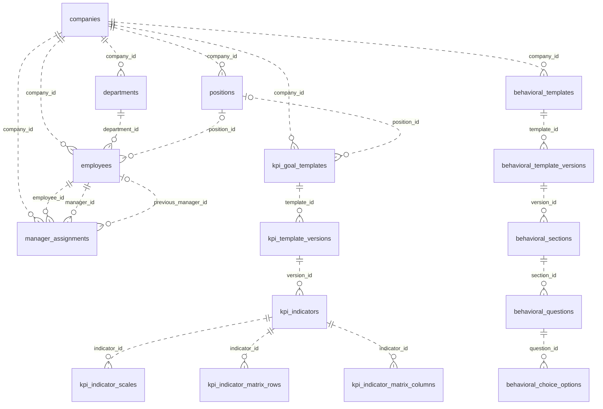
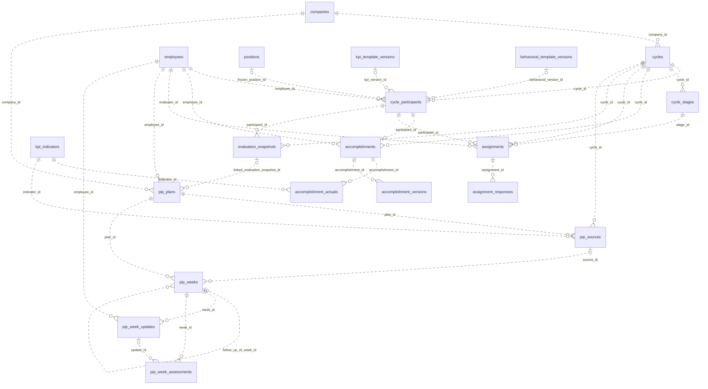
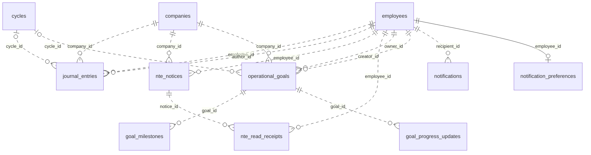
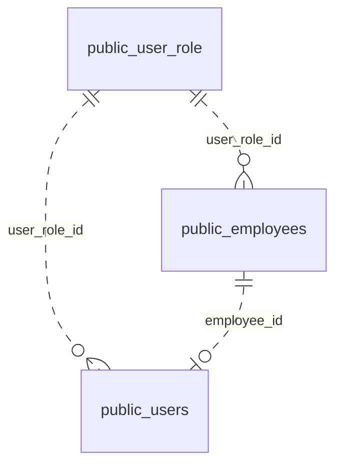

# Database Schema

**System:** HRDotNet Performance (PMS)  
**Source:** PRD v2.0 (26 October 2026) and supplied Database Design  
**Database dialect:** PostgreSQL  
**Status:** Logical production design; not an executable migration specification

## 1. Purpose and scope

This document describes the logical relational model for the production backend. It covers identity and directory data, manager assignments, KPI and behavioral templates, review cycles, accomplishments, evaluator assignments, evaluation snapshots, 202 Files, PIP, operational goals, notifications and audit events.

The supplied database design is the schema authority for this document. The PRD remains the authority for workflow behavior. Where the design leaves a physical detail unspecified, this document identifies it as an implementation decision rather than inventing a definitive constraint.

## 2. Global conventions

- Use PostgreSQL and `snake_case` identifiers.
- Use `uuid` primary keys unless a table explicitly specifies otherwise.
- Use `timestamptz` for timestamps. Company calendar dates use Asia/Manila semantics as described by the PRD.
- Tables carry `created_at` and `updated_at` unless they are immutable/frozen records; frozen records carry `frozen_at`.
- Preserve business records through state, `archived_at`, or `cancelled_at`; do not physically delete business history.
- Use an append-only `audit_events` table.
- Apply idempotency keys to workflow mutations where the PRD requires idempotent processing.
- Enforce complex business invariants in the application/service layer when they depend on projected state, multi-row evaluation, or workflow context.

## 3. Identity and organization

### 3.1 `companies`

| Column                     | Type        | Notes                        |
| -------------------------- | ----------- | ---------------------------- |
| `company_id`               | uuid PK     | Company identity             |
| `name`                     | text        | Company name                 |
| `demo_mode`                | boolean     | Demo clock mode              |
| `demo_date`                | date        | Validated demo calendar date |
| `created_at`, `updated_at` | timestamptz | Standard timestamps          |

### 3.2 `employees`

| Column                     | Type          | Notes                                                                |
| -------------------------- | ------------- | -------------------------------------------------------------------- |
| `employee_id`              | uuid PK       | Stable employee identity                                             |
| `company_id`               | uuid FK       | References `companies`                                               |
| `hrdotnet_id`              | text nullable | HRDotNet source reference; nullable before integration               |
| `employee_number`          | text          | Employee number                                                      |
| `first_name`, `last_name`  | text          | Employee name                                                        |
| `position_id`              | uuid FK       | References `positions`                                               |
| `department`               | text          | Department                                                           |
| `status`                   | text          | Active/inactive; rehire and termination behavior follows PRD Dir-009 |
| `created_at`, `updated_at` | timestamptz   | Standard timestamps                                                  |

### 3.3 `positions`

| Column                     | Type        | Notes               |
| -------------------------- | ----------- | ------------------- |
| `position_id`              | uuid PK     | Position identity   |
| `company_id`               | uuid FK     | Company scope       |
| `title`                    | text        | Position title      |
| `created_at`, `updated_at` | timestamptz | Standard timestamps |

## 4. Effective-dated manager assignments

### `manager_assignments`

| Column                                            | Type                 | Notes                                        |
| ------------------------------------------------- | -------------------- | -------------------------------------------- |
| `assignment_id`                                   | uuid PK              | Assignment identity                          |
| `employee_id`                                     | uuid FK              | Employee receiving manager                   |
| `manager_id`                                      | uuid FK              | Assigned manager                             |
| `company_id`                                      | uuid FK              | Company scope                                |
| `effective_date`                                  | date                 | On or after current company date             |
| `status`                                          | text                 | `pending`, `applied`, `blocked`, `cancelled` |
| `previous_manager_id`                             | uuid FK nullable     | Set when applied                             |
| `apply_reason`, `cancel_reason`, `blocked_reason` | text nullable        | Workflow explanations                        |
| `applied_at`, `cancelled_at`, `blocked_at`        | timestamptz nullable | State timestamps                             |
| `idempotency_key`                                 | text                 | Duplicate-application protection             |
| `created_at`, `updated_at`                        | timestamptz          | Standard timestamps                          |

Application invariants: no self-assignment, employee and manager must belong to the same company, and the projected reporting graph must not contain a reporting loop. Validate the complete proposed batch and revalidate at effective date.

## 5. KPI templates

### 5.1 `kpi_goal_templates`

Template identity and lifecycle: `template_id` UUID PK, `position_id` FK, `company_id` FK, `status` (`draft`, `published`, `archived`), `current_version`, `published_by`, `published_at`, `archived_at`, timestamps.

### 5.2 `kpi_template_versions`

Immutable version records: `version_id` UUID PK, `template_id` FK, `version` integer, `frozen_at` nullable until publication, `created_by` FK, `created_at`.

### 5.3 `kpi_indicators`

Indicator rows belong to a template version: `indicator_id` UUID PK, `version_id` FK, `name`, `description`, `unit`, nonnegative numeric `target`, `direction` (`higher_is_better` / `lower_is_better`), positive `weight` (`numeric(5,2)`), `score_target_met` integer 1–5, `score_below_target` integer 1–5, and `use_for_scoring` boolean.

### 5.4 `kpi_indicator_scales`

One row per threshold band: `scale_id` UUID PK, `indicator_id` FK, inclusive `lower_bound`, inclusive `upper_bound` (NULL for the final unbounded range), and `score` integer 1–5.

### 5.5 `kpi_indicator_matrix_rows` and `kpi_indicator_matrix_columns`

Flexible reference-matrix structure associated with an indicator. The supplied design identifies row/column IDs, indicator FK, row/column labels and reference cell values. Confirm the exact physical cell representation and uniqueness keys during migration design.

Published template versions and their scoring criteria must not be mutated after being frozen. Existing cycle snapshots remain unchanged when a later template version is published.

## 6. Behavioral assessment templates

- `behavioral_templates` and `behavioral_template_versions`: template identity/status and immutable version split, matching the KPI template pattern.
- `behavioral_sections`: `section_id` UUID PK, `version_id` FK, `title`, `sort_order`.
- `behavioral_questions`: `question_id` UUID PK, `section_id` FK, `prompt`, `question_type` (`rating_scale`, `short_answer`, `paragraph`, `multiple_choice`), `is_required`, `allow_not_observed` (rating only), `sort_order`.
- `behavioral_choice_options`: `option_id` UUID PK, `question_id` FK, distinct `label`.

Only observed numeric rating answers from 1–5 contribute to behavioral scoring. Not Observed, optional unanswered items, narrative answers and multiple-choice answers are excluded from numeric scoring.

## 7. Review cycles

### 7.1 `cycles`

`cycle_id` UUID PK; `company_id` FK; `name`; `review_type` (`standard`, `360`, `probationary`, `project_based`); `state` (`draft`, `scheduled`, `active`, `completed`, `cancelled`); `evaluation_start`, `evaluation_end` dates; `assessment_start`, `verification_deadline` timestamptz; `activation_date` date; `goals_weight`, `behavioral_weight` numeric; `anonymity_threshold` integer 2–10; `cancelled_reason`; `finalized_at`, `released_at`; `idempotency_key`; timestamps.

The bootstrap SQL enforces component weights between 0 and 1 and a combined total of 1 (100 percent).

### 7.2 `cycle_participants`

`participant_id` UUID PK; `cycle_id` FK; `employee_id` FK; `frozen_position_id` FK; `kpi_version_id` FK; `behavioral_version_id` FK; `created_at`.

Unique key: `(cycle_id, employee_id)`.

### 7.3 `cycle_stages`

`stage_id` UUID PK; `cycle_id` FK; `perspective` (`self`, `manager`, `hr`, `peer`, `upward`); `evaluator_role`; `sort_order`; `deadline`.

Cycle activation creates participant and assignment records transactionally and idempotently. Template and position mappings are frozen at scheduling or launch as required by the PRD.

## 8. KPI accomplishments

- `accomplishments`: one per cycle participant; `accomplishment_id` UUID PK, `participant_id` FK, `cycle_id`, `employee_id`, `status` (`draft`, `submitted`, `returned`, `verified`), remarks, submit/verify actor and timestamps, return reason, standard timestamps. Unique `(participant_id)`.
- `accomplishment_actuals`: one row per indicator per accomplishment; `actual_id` UUID PK, `accomplishment_id` FK, `indicator_id` FK, nonnegative `actual_value` (nullable in draft), timestamps. Unique `(accomplishment_id, indicator_id)`.
- `accomplishment_versions`: correction snapshots; `version_id` UUID PK, `accomplishment_id` FK, version number, `actuals_json`, remarks, actor, acted timestamp and correction reason.

Every correction/resubmission after return retains the prior submitted values and actor/time evidence.

## 9. Evaluator assignments

- `assignments`: `assignment_id` UUID PK, `cycle_id` FK, `participant_id` FK (subject), `evaluator_id` FK, `stage_id` FK, state (`locked`, `not_started`, `in_progress`, `submitted`, `completed`), deadline, submission/completion actor and timestamps, standard timestamps. Unique `(participant_id, evaluator_id, stage_id)`.
- `assignment_responses`: one row per response version, unique on `(assignment_id, version)`; `response_id` UUID PK, `assignment_id` FK, `answers_json` keyed by question ID, version, status (`draft`, `submitted`), submit actor/time, `reopen_reason`, `created_at`.

Assignment ownership and manager reassignment follow the workflow rules in the PRD.

### Finalization, scoring, and result release

`evaluation_snapshots` lives in the evaluation results module. It stores one snapshot per cycle and participant, with component scores, overall score, and frozen evidence. SQL requires `finalized_at` before `released_at` and rejects release timestamps earlier than finalization. Services enforce evidence immutability and decide who can see released results.

## 10. 202 Files

- `journal_entries`: `entry_id`, employee FK, author FK, company FK, entry date/type/title/description, optional cycle FK, created timestamp.
- `nte_notices`: `notice_id`, employee/company FKs, category, subject, body, explanation deadline, optional incident date/reference, status (`draft`, `issued`, `responded`, `closed`, `cancelled`), one explanation text and submitted timestamp, early-close/cancel reasons, issue/close actor and timestamps, standard timestamps.
- `nte_read_receipts`: `receipt_id`, notice FK, employee FK, `opened_at`.

An issued NTE is locked. An employee may submit one explanation while the notice remains open, including after the deadline. Early closure and cancellation are distinct reasoned actions.

## 11. Performance Improvement Plan

- `pip_plans`: plan identity, employee/company FKs, origin (`automatic`, `manual`), state (`awaiting_planning`, `draft`, `active`, `completed`, `not_met`, `cancelled`), referral review flag, completion/cancel notes, optional linked evaluation snapshot, creator/time, closed timestamp.
- `pip_sources`: source indicator evidence; plan/cycle/indicator FKs, frozen actual/target, direction/unit/score/matrix criteria JSON, optional covered week, exclusion reason, referral-reviewed flag. Unique `(plan_id, cycle_id, indicator_id)`.
- `pip_weeks`: plan FK, optional source FK, focus, goal description, target/unit/direction, inclusive start/end dates, status (`pending`, `active`, `completed`, `not_met`), optional follow-up week/reason, missed-assessment reason, timestamps.
- `pip_week_updates`: week FK, employee FK, status (`draft`, `submitted`, `returned`), progress actual, remarks, return reason, submitted/updated timestamps.
- `pip_week_assessments`: week FK, optional update FK, assessor UUID, outcome (`met`, `not_met`, `missed`), verified actual, remarks, required missed reason when outcome is `missed`, assessed timestamp.

A PIP source is identified by cycle plus indicator, not indicator alone. Weekly sections are inclusive seven-day periods and must not overlap sibling weeks. Automatic referral requires a completed and released evaluation with at least one individually verified measurable below-target indicator.

## 12. Operational goals and milestones

- `operational_goals`: owner/creator/company FKs, name/description/category (`quality`, `delivery`, `growth`, `collaboration`), optional cycle FK, start/due dates, progress percentage 0–100, tracking mode (`manual`, `milestone`), status (`active`, `pending_approval`, `completed`), version for stale-write detection, timestamps.
- `goal_milestones`: goal FK, title, optional due date, done flag, completed timestamp, status (`pending`, `completed`, `completed_late`, `overdue`), timestamps.
- `goal_progress_updates`: goal FK and actor UUID, progress percentage, optional comment, milestone snapshot JSON, updated timestamp.

Operational goals are separate from KPI scoring.

## 13. Notifications and audit

### `notifications`

`notification_id` UUID PK, recipient FK, source type (`assignment`, `nte`, `pip`), source ID, message, optional `read_at`, `created_at`.

### `notification_preferences`

`employee_id` UUID PK/FK and `review_notifications_enabled` boolean.

### `audit_events`

Append-only event table: `event_id` UUID PK, `entity_type`, `entity_id`, `action`, `actor_id`, optional `reason`, optional `before_json` / `after_json`, optional `idempotency_key`, `occurred_at`.

No UPDATE or DELETE is permitted on `audit_events`. Access is through role-scoped views or authorized application queries.

## 14. Key relationship map

These diagrams show the foreign keys declared by the modular bootstrap SQL. A label names the foreign-key column in the child table. The diagrams group related tables by workflow so each remains readable.

### Directory and frozen templates

### Review cycle, results, and improvement plans

Employee UUID foreign keys reference `pms.employees.guid`. The snapshot unique key covers the pair `(cycle_id, participant_id)`.

### 202 Files, operational goals, and notifications

`notifications.source_id` and `audit_events.entity_id` can refer to different kinds of records. SQL defines no foreign key on either column.

### Public identity reference

This diagram describes the identity reference draft. The package bootstrap creates standalone `public.users` and `pms.user_role` without identity foreign keys. See the workspace blueprint for the open TypeORM alignment decision.

## 15. Integrity and implementation notes

1. Add foreign keys for every relationship identified above.
2. Implement unique keys explicitly listed in the supplied design.
3. Add indexes for frequent company-scoped, employee-scoped, status, due-date and foreign-key lookups after query patterns are confirmed.
4. Use transactions for cycle activation, finalization/release transitions, NTE issue/close, PIP planning/assessment and manager-assignment application.
5. Use idempotency keys for retried workflow commands.
6. Use optimistic concurrency/version checks for operational goals and any mutable record exposed to concurrent editing.
7. Validate cross-row rules in the service layer: KPI indicator weight totals, threshold continuity/order, manager reporting graph, non-overlapping PIP weeks, cycle readiness and role/company scope.
8. Confirm unresolved physical details before migrations: matrix cell table shape, exact FK columns on denormalized records, composite company-aware FK strategy, indexes, enum/check constraints, deletion behavior and attachment storage.
9. Apply explicit migrations to existing databases to enforce new bootstrap constraints. Track backups, retention, encryption, and production authorization separately.
