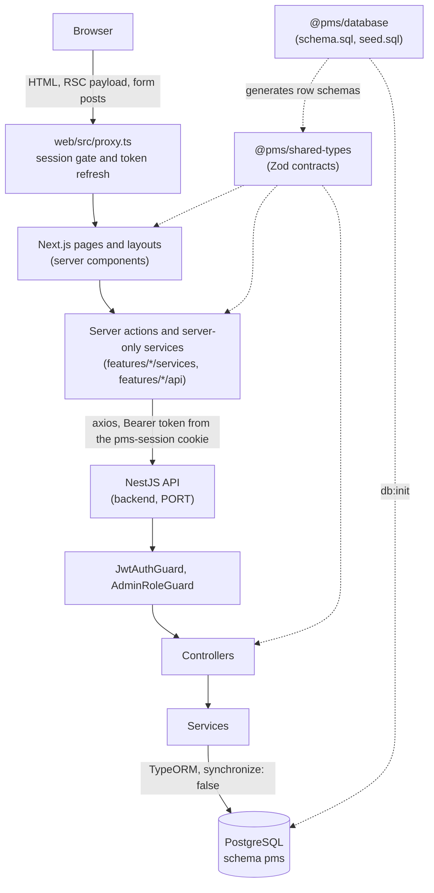
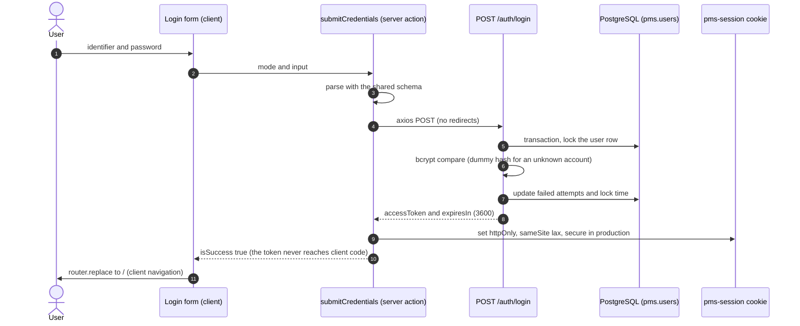
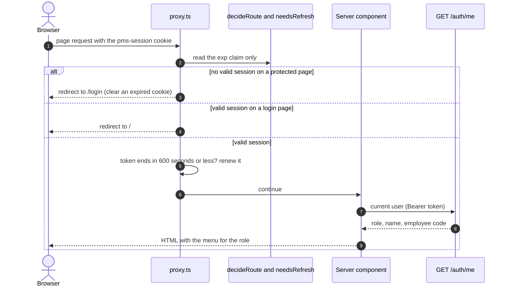
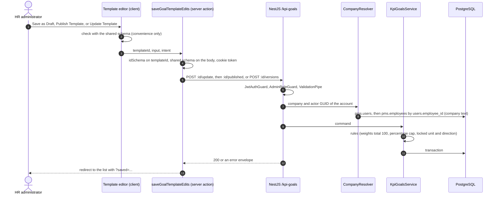

# System Architecture

> Purpose: Document the topology, technology stack, directory layout, module boundaries, request flows, and architectural invariants of the HRDotNet Performance Management System (PMS), so engineering decisions keep the structure intact. Every statement comes from the code and configuration in this repository on the date below. Where the code and another document disagree, this file follows the code and says so.

Last updated: 2026-11-20

Related documents: [project-structure.md](project-structure.md) (folder rules), [workspace-blueprint.md](workspace-blueprint.md) (ownership, builds, releases), [error-handling.md](error-handling.md) (error envelope), [api-contracts.md](api-contracts.md) (endpoints), [database-design.md](database-design.md) and [database-schema.md](database-schema.md) (data model), [security-policies.md](security-policies.md) (security rules).

---

## 1. High-Level System Overview & Topology

PMS is a pnpm monorepo with two applications and two internal packages.

- `web` is a Next.js 16 App Router application. It renders pages on the server and calls the backend only from the server side (server components, server actions, and `proxy.ts`). The browser never calls the backend directly.
- `backend` is a NestJS 12 REST API organized as a modular monolith: one feature module per business area, each with controllers, services, DTOs, and entities.
- `packages/shared-types` holds the Zod contracts (enums, generated row schemas, request and response schemas, shared rules) that `web` and `backend` both import.
- `packages/database` holds the PostgreSQL schema, the development seed, and the init script.

The API is the only component that reads or writes a database. It holds one connection: the PostgreSQL database, schema `pms` (read and write).



What the system does not have today: no API gateway or reverse proxy in the repository, no cache layer, no message queue or event bus, no background jobs, and no health endpoint (`@nestjs/terminus` is listed in `backend/package.json` and no source file imports it). The SMTP variables in `backend/.env.example` are not read by any source file.

### 1.1 Runtime components

| Component         | Where it runs                                             | Responsibility                                               | Entry point                                  |
| ----------------- | --------------------------------------------------------- | ------------------------------------------------------------ | -------------------------------------------- |
| Web app           | Node 24, Next.js 16.4 (`cacheComponents`, React Compiler) | Pages, session gate, server actions, UI                      | `web/src/app/layout.tsx`, `web/src/proxy.ts` |
| API               | Node 24, NestJS 12                                        | Authentication, authorization, business rules, persistence   | `backend/src/main.ts`                        |
| Main database     | PostgreSQL                                                | System of record for PMS data                                | Connection in `backend/src/app.module.ts`    |
| Contracts package | Built to `dist/` with `tsc`                               | Zod schemas and shared rules for both apps                   | `packages/shared-types/src/index.ts`         |
| Database package  | Node script                                               | Creates the database, applies `schema.sql`, loads `seed.sql` | `packages/database/init-db.mjs`              |

Ports in development: the web app listens on 3000. The API reads `PORT` (default 3000), so set it to 4000 to run both. Swagger is at `/swagger` on the API.

Deployment targets are not recorded in the repository. `docs/workspace-blueprint.md` states that `web` and `backend` are private apps that deploy from a commit or a tag on `main`. No Dockerfile or deploy workflow is tracked. `backend/package.json` has a `deploy` script (`nest deploy`).

### 1.2 Implementation status

| Area                                                                              | State                                                                                                                                                                                                                                                                                                                                                                                                                                                                                                                                                                                                                                                                                                                                                 |
| --------------------------------------------------------------------------------- | ----------------------------------------------------------------------------------------------------------------------------------------------------------------------------------------------------------------------------------------------------------------------------------------------------------------------------------------------------------------------------------------------------------------------------------------------------------------------------------------------------------------------------------------------------------------------------------------------------------------------------------------------------------------------------------------------------------------------------------------------------- |
| Authentication (login, refresh, current user)                                     | Wired end to end: web server action, API, httpOnly cookie, route gate                                                                                                                                                                                                                                                                                                                                                                                                                                                                                                                                                                                                                                                                                 |
| Workspace shell (sidebar by role, header, notification menu, account menu, theme) | Built                                                                                                                                                                                                                                                                                                                                                                                                                                                                                                                                                                                                                                                                                                                                                 |
| KPI Goal Templates (list, details, create, edit, publish, new version)            | Wired end to end across shared-types, backend, and web                                                                                                                                                                                                                                                                                                                                                                                                                                                                                                                                                                                                                                                                                                |
| Employees API                                                                     | Built in the backend. The web `employees` page is a placeholder                                                                                                                                                                                                                                                                                                                                                                                                                                                                                                                                                                                                                                                                                       |
| Behavioral assessment templates API                                               | Built in the backend. The web page is a placeholder and `behavioral-template-editor.tsx` is not routed                                                                                                                                                                                                                                                                                                                                                                                                                                                                                                                                                                                                                                                |
| Review cycles, evaluations, position goals components                             | The register (`review-cycles-table.tsx`, `review-cycles-content.tsx`) is wired to `GET /review-cycles`. `/review-cycles/new` is the create wizard and `/review-cycles/[cycle-id]/edit` edits a draft (details, participants, templates, stages, review, with readiness per step). The edit page also launches and cancels. `/review-cycles/[cycle-id]` shows a launched or finished cycle (Overview, Participants, Progress, Results) and cancels a scheduled or active one. The register, Goals of others, and the behavioral templates filter in the browser. `/reviews` lists the review assignments from `GET /reviews`, with tabs, filtered and paged by the server. `/reviews/[assignment-id]` shows one review, saves a draft, and submits it. |
| KPI accomplishments                                                               | `/goals` lists the KPI reports from `GET /accomplishments`: your own, then those of your team or company. `/goals/[accomplishment-id]` shows one report with its frozen indicators and history; the employee saves and submits it, and the current manager verifies or returns it                                                                                                                                                                                                                                                                                                                                                                                                                                                                     |
| Placeholder pages                                                                 | `202-files`, `employees`, `my-team`, `pip`, `reports`, `behavioral-assessment-template`                                                                                                                                                                                                                                                                                                                                                                                                                                                                                                                                                                                                                                                               |
| Dashboard                                                                         | Page header only                                                                                                                                                                                                                                                                                                                                                                                                                                                                                                                                                                                                                                                                                                                                      |
| Database tables                                                                   | 39 tables in schema `pms` (`packages/database/schema/`), none in `public`. Backend entities exist only for accounts, employees, roles, KPI goal templates, and behavioral assessment templates                                                                                                                                                                                                                                                                                                                                                                                                                                                                                                                                                        |

---

## 2. Technology Stack & Decision Matrix

Versions come from the manifests (`package.json` files and `pnpm-workspace.yaml`). A range such as `^12.0.1` means the lockfile fixes the installed version. Evaluated alternatives and the reasons for each choice are recorded in the repository only where the table says so. Everywhere else the table says "Not recorded", and the decision needs its owner before anyone relies on a reason.

| Layer / Concern     | Chosen technology                                                                                                                                                                                            | Evaluated alternatives      | Rationale and trade-off                                                                                                                            |
| ------------------- | ------------------------------------------------------------------------------------------------------------------------------------------------------------------------------------------------------------ | --------------------------- | -------------------------------------------------------------------------------------------------------------------------------------------------- |
| Language            | TypeScript. Catalog `5.9.3` (root, web, shared-types). Backend pins `^6.0.2`                                                                                                                                 | Not recorded                | `docs/workspace-blueprint.md`: the backend keeps its own TypeScript, Vitest, `@types/node`, and `axios` versions until the backend team moves them |
| Runtime             | Node 24 (CI `node-version: 24`). Web types use `@types/node` 20, backend types use 24                                                                                                                        | Not recorded                | Not recorded                                                                                                                                       |
| Package manager     | pnpm 12.23.0 (`packageManager` in root `package.json`). Version catalog in `pnpm-workspace.yaml` for `eslint`, `prettier`, `typescript`, `zod`                                                               | Not recorded                | One version for tools that more than one package uses                                                                                              |
| Web framework       | Next.js 16.4.5, App Router, `cacheComponents`, `partialPrefetching`, React Compiler, Turbopack                                                                                                               | Not recorded                | Not recorded                                                                                                                                       |
| UI                  | React 19.3.0, Tailwind CSS 4, shadcn CLI `^4.23` on `@base-ui/react` `^1.9`, `lucide-react`, Recharts 3.8.0                                                                                                  | Not recorded                | Design rules are in `web/DESIGN.md` and `web/llm.txt`                                                                                              |
| Web state and forms | TanStack Query `^5.107`, TanStack Table `^9.3`, Zustand `^5.1`, react-hook-form `^7.91`, `@hookform/resolvers`                                                                                               | Not recorded                | `web/llm.txt`: Zustand for client UI state, TanStack Query for server state, never Zustand for server records                                      |
| API framework       | NestJS 12 (`@nestjs/common`, `core`, `platform-express`), Swagger, Passport JWT (`@nestjs/jwt`, `@nestjs/passport`, `passport-jwt`)                                                                          | Not recorded                | Not recorded                                                                                                                                       |
| API validation      | `class-validator` `^0.15` and `class-transformer` with a global `ValidationPipe`. Zod for environment variables                                                                                              | Not recorded                | Request DTOs stay consistent with the shared Zod contracts (`backend/AGENTS.md`)                                                                   |
| Contracts           | Zod `^4.6.7` (catalog) in `@pms/shared-types`                                                                                                                                                                | Not recorded                | One definition of each enum, row, and request shape for both apps                                                                                  |
| Primary datastore   | PostgreSQL. Version not recorded. Default dev port 5433                                                                                                                                                      | Not recorded                | Not recorded                                                                                                                                       |
| ORM                 | TypeORM `^1.1.2` with `synchronize: false` (the SQL files own the tables)                                                                                                                                    | Not recorded                | `docs/workspace-blueprint.md` records the rule: the SQL files own the schema, and `backend/src/entity-schema.spec.ts` keeps every entity in `pms`  |
| Password hashing    | `bcryptjs` `^3` in `AuthService`. `bcrypt` `^6` is also a dependency                                                                                                                                         | Not recorded                | Not recorded                                                                                                                                       |
| Cache               | None                                                                                                                                                                                                         | Not applicable              | Not applicable                                                                                                                                     |
| Messaging and jobs  | None                                                                                                                                                                                                         | Not applicable              | Not applicable                                                                                                                                     |
| Observability       | `@nestjs/observe` `^0.1.8` registered in `app.module.ts` with the literal placeholders `YOUR_APP_KEY` and `YOUR_APP_SECRET`. Nest `Logger` in the exception filter. `x-correlation-id` header on every error | Not recorded                | Not recorded                                                                                                                                       |
| HTTP client (web)   | axios `^1.21`, server only, `http` adapter, `maxRedirects: 0`, 10 second timeout per request                                                                                                                 | Not recorded                | Keeps the access token out of client code                                                                                                          |
| Tests               | Vitest (web `^5.1`, backend `^4.1`), Testing Library, `vitest-axe`, `msw`, `supertest`, `node:test` for packages. Playwright `^1.65` is a web dev dependency and `web/tests/e2e/` holds only `.gitkeep`      | Not recorded                | Not recorded                                                                                                                                       |
| Lint and format     | ESLint 9 (root for `packages/`, `eslint-config-next` for web), oxlint `^1.58` for backend, Prettier, Husky `^9`, lint-staged `^16`                                                                           | Not recorded                | Not recorded                                                                                                                                       |
| CI                  | GitHub Actions `ci.yml`: affected-only typecheck, lint, build, test                                                                                                                                          | Remote build cache deferred | `docs/workspace-blueprint.md`: add Turborepo or Nx when the full CI run takes more than about 5 minutes                                            |

### 2.1 Environment variables

The API validates its environment at startup in `backend/src/config/env.config.ts` and stops with the names of the bad variables.

| Variable                                                                              | Used by | Rule                                                                                                              |
| ------------------------------------------------------------------------------------- | ------- | ----------------------------------------------------------------------------------------------------------------- |
| `PORT`                                                                                | backend | Number, default 3000                                                                                              |
| `POSTGRES_HOST`, `POSTGRES_PORT`, `POSTGRES_DB`, `POSTGRES_USER`, `POSTGRES_PASSWORD` | backend | Defaults: `localhost`, 5433, `postgres`, `postgres`, empty. Not listed in `backend/.env.example`                  |
| `DB_CONNECTION_TIMEOUT`, `DB_REQUEST_TIMEOUT`                                         | backend | Number of milliseconds, default 30000                                                                             |
| `JWT_ACCESS_SECRET`                                                                   | backend | Required, not blank                                                                                               |
| `PMS_API_BASE_URL`                                                                    | web     | Base URL of the API, `http` or `https` only. Without it, server actions report that the service is not configured |

`backend/.env.example` also lists `DB_SYNCHRONIZE`, `DB_LOGGING`, `APP_BASE_URL`, `JWT_REFRESH_SECRET`, and the `SMTP_*` variables. `env.config.ts` does not declare them (the schema is a `looseObject`, so extra variables pass) and no source file reads `SMTP_*`, `APP_BASE_URL`, or `JWT_REFRESH_SECRET`.

---

## 3. Directory Layout & Module Isolation

The intended structure is one folder per kind of file and dependencies that point inward. The trees below show what is on disk today. The rules after the trees state the intent and list where the code breaks it. This section is generated from `git ls-files` plus the untracked `docs/system-architecture.md`, so every tracked file appears once. The comments after `#` describe a file only where its job was read or its name states it.

### 3.1 Repository root

33 files are tracked outside the three expanded folders.

```text
performance-management-system/
├── .github/                                     # Review ownership and CI
│   ├── workflows/                               # GitHub Actions
│   │   └── ci.yml                               # Typecheck, lint, build, and test the affected workspaces
│   └── CODEOWNERS                               # Review owners per path
├── .husky/                                      # Git hooks
│   └── pre-commit                               # Runs lint-staged before each commit
├── backend/                                     # @pms/backend: NestJS API (expanded in 3.3)
├── docs/                                        # Product and engineering documents
│   ├── handoffs/                                # State snapshots for whoever continues a piece of work
│   │   ├── 2026-11-12-backend-restructure.md    # Backend restructure
│   │   ├── 2026-11-13-auth-integration.md       # Auth integration
│   │   ├── 2026-11-13-post-auth-integration.md  # Post-auth integration
│   │   ├── 2026-11-19-kpi-goal-templates.md     # KPI Goal Templates module
│   │   ├── 2026-11-20-session-kpi-verification-and-architecture-doc.md # KPI verification and the architecture doc
│   │   ├── 2026-11-24-auth-pms-schema.md        # Auth and employees on the pms schema
│   │   ├── 2026-11-24-behavioral-module-status.md
│   │   ├── 2026-11-24-behavioral-template-details-and-edit.md
│   │   ├── 2026-11-24-behavioral-template-new-version.md
│   │   ├── 2026-11-24-behavioral-template-web.md
│   │   ├── 2026-11-24-kpi-text-and-pms-only.md  # KPI after PR 8, pms only, text company
│   │   └── README.md                            # Index of the handoffs
│   ├── reviews/                                 # Reviews of a change
│   │   └── 2026-11-24-auth-pms-schema-review.md # Review of PR 8 from the KPI side
│   ├── api-contracts.md                         # Endpoints and response shapes
│   ├── behavioral-assessment-web-integration.md # Paused scope note
│   ├── coding-standards.md                      # Backend coding conventions
│   ├── database-design.md                       # The logical model
│   ├── database-schema.md                       # Tables and columns
│   ├── engineering-rules.md                     # Rules for every change
│   ├── error-handling.md                        # Error categories, envelope, and status codes
│   ├── legacy-gap-analysis.md                   # What the legacy web app has that web/ lacks
│   ├── product-requirements-document.md         # What the system does
│   ├── project-structure.md                     # Folder map and folder rules
│   ├── README.md                                # Index of the documents
│   ├── security-policies.md                     # Security rules
│   ├── system-architecture.md                   # This file
│   └── workspace-blueprint.md                   # Workspaces, ownership, builds, and releases
├── packages/                                    # Internal packages (expanded in 3.5)
├── web/                                         # @pms/web: Next.js app (expanded in 3.4)
├── .gitignore                                   # Ignores local tooling, build output, env files, and the progress report
├── .prettierignore                              # Paths Prettier skips
├── .prettierrc                                  # Prettier settings
├── AGENTS.md                                    # Repository rules for coding agents
├── CLAUDE.md                                    # Claude Code entry point, imports AGENTS.md
├── eslint.config.mjs                            # ESLint for packages/: naming rules and the shared-types import boundary
├── package.json                                 # Root scripts and lint-staged rules
├── pnpm-lock.yaml                               # Lockfile
├── pnpm-workspace.yaml                          # Workspaces (web, backend, packages/*) and the version catalog
├── README.md                                    # Overview, setup, and commands
├── sauron.config.yaml                           # Settings of the Sauron agent tooling
└── tsconfig.base.json                           # Shared TypeScript compiler options
```

### 3.2 Local tooling (not tracked)

These folders and files exist in the working copy and are listed in `.gitignore`. They are per-developer agent tooling. Keep them apart from the tracked rules in `AGENTS.md` and `CLAUDE.md`. A `sauron add` or `sauron sync` can overwrite them.

```text
performance-management-system/
├── .agents/                       # Agent anti-patterns and skills (local)
│   ├── anti-patterns.md
│   └── skills/
├── .claude/                       # Claude Code settings, agents, commands, rules, skills, workflows (local)
│   ├── README.md
│   ├── agent-memory/
│   ├── agents/
│   ├── commands/
│   ├── docs/
│   ├── output-styles/
│   ├── rules/
│   ├── settings.json
│   ├── skills/
│   └── workflows/
├── .codex/                        # Codex config, prompts, and the user's database scripts (local)
│   ├── README.md
│   ├── config.toml
│   ├── prompts/
│   └── scripts/                   # SQL scripts run by hand (account link, ALTERs). Never committed
├── .sauron/                       # Sauron manifest and backups (local)
│   ├── backups/
│   └── manifest.json
├── node_modules/                  # Installed packages
└── progress-report-result.md      # Output of the progress-report command
```

`.gitignore` also excludes `dist/`, `.next/`, `.env*` (except `.env.example`), `*.tsbuildinfo`, `.pnpm-store/`, `coverage/`, and `.docs/`.

### 3.3 `backend/` (NestJS API)

Each feature is one module under `src/modules/`. Every folder inside a module holds one kind of file and every file has one job.

```text
backend/                                                # @pms/backend: NestJS API (expanded in 3.3)
├── src/
│   ├── common/                                         # Code that two or more modules use
│   │   ├── decorators/
│   │   │   └── matches.decorator.ts                    # Validator: one field equals another
│   │   ├── dtos/
│   │   │   └── api-response.dto.ts                     # Swagger description of the error envelope
│   │   ├── entities/
│   │   │   └── audit-event.entity.ts                   # pms.audit_events: append-only, the code only inserts (written by common/audit/write-audit.ts)
│   │   ├── filters/
│   │   │   ├── api-exception.filter.spec.ts
│   │   │   └── api-exception.filter.ts                 # Global filter: every failure leaves as the shared error envelope
│   │   ├── guards/
│   │   │   └── jwt-auth.guard.ts                       # Requires a valid Bearer JWT
│   │   ├── rate-limit/
│   │   │   ├── global-interceptors.ts                  # The interceptors of every request
│   │   │   ├── rate-limit.decorator.ts                 # The routes with their own limits
│   │   │   ├── rate-limit.interceptor.ts               # 429 with Retry-After over a limit
│   │   │   └── rate-limiter.ts                         # Fixed windows in memory
│   │   └── pipes/
│   │       ├── parse-guid.pipe.spec.ts
│   │       ├── global-pipes.ts                         # The pipes of every request
│   │       ├── nul-character.pipe.ts                   # 400 for input with a NUL character
│   │       ├── parse-version.pipe.spec.ts
│   │       ├── parse-version.pipe.ts                      # A version number of a route: 1 to the integer limit
│   │       └── parse-guid.pipe.ts                      # A route id: any GUID, so the dev ids without a version digit pass
│   ├── config/
│   │   ├── env.config.spec.ts
│   │   └── env.config.ts                               # Zod schema of the environment variables, checked at startup
│   ├── modules/                                        # One folder per feature module
│   │   ├── auth/                                       # Routes: login, refresh-token, me
│   │   │   ├── controllers/
│   │   │   │   ├── auth.controller.spec.ts
│   │   │   │   └── auth.controller.ts
│   │   │   ├── dtos/
│   │   │   │   ├── current-user-response.dto.ts
│   │   │   │   ├── login.dto.ts
│   │   │   │   ├── password-length.spec.ts
│   │   │   │   ├── refresh-token.dto.ts
│   │   │   │   └── token-response.dto.ts
│   │   │   ├── entities/
│   │   │   │   ├── user-role.entity.ts                 # user_role and ADMIN_ROLE_ID
│   │   │   │   └── user.entity.ts                      # users: credentials, failed login count, lock time
│   │   │   ├── services/
│   │   │   │   ├── account-registration.service.ts     # signUp(): no route calls it
│   │   │   │   ├── auth.service.spec.ts
│   │   │   │   └── auth.service.ts                     # Login with lockout, token issue and refresh, current user
│   │   │   ├── strategies/
│   │   │   │   └── jwt.strategy.ts                     # Passport JWT strategy, token from the Bearer header
│   │   │   ├── types/
│   │   │   │   └── jwt-payload.types.ts
│   │   │   └── auth.module.ts
│   │   ├── behavioral-assessment/                      # Routes: list, get, create, update, published
│   │   │   ├── controllers/
│   │   │   │   ├── behavioral-assessment.controller.spec.ts
│   │   │   │   └── behavioral-assessment.controller.ts
│   │   │   ├── dtos/
│   │   │   │   ├── behavioral-section.dto.ts
│   │   │   │   ├── behavioral-template-contract.spec.ts
│   │   │   │   ├── create-behavioral-template.dto.ts
│   │   │   │   └── update-behavioral-template.dto.ts
│   │   │   ├── entities/
│   │   │   │   ├── behavioral-choice-option.entity.ts
│   │   │   │   ├── behavioral-question.entity.ts
│   │   │   │   ├── behavioral-section.entity.ts
│   │   │   │   ├── behavioral-template-version.entity.ts
│   │   │   │   └── behavioral-template.entity.ts
│   │   │   ├── services/
│   │   │   │   ├── behavioral-assessment.service.spec.ts
│   │   │   │   └── behavioral-assessment.service.ts
│   │   │   ├── types/
│   │   │   │   └── template-tree.types.ts
│   │   │   └── behavioral-assessment.module.ts
│   │   ├── employees/                                  # Routes: list, get, create, update, me/profile
│   │   │   ├── controllers/
│   │   │   │   ├── employees.controller.spec.ts
│   │   │   │   └── employees.controller.ts
│   │   │   ├── dtos/
│   │   │   │   ├── create-employee.dto.ts
│   │   │   │   ├── employee-page.dto.ts
│   │   │   │   ├── list-employees-query.dto.ts
│   │   │   │   └── update-employee.dto.ts
│   │   │   ├── entities/
│   │   │   │   └── employee-domain.entity.ts           # pms.employees (directory)
│   │   │   ├── guards/
│   │   │   │   ├── admin-role.guard.spec.ts
│   │   │   │   └── admin-role.guard.ts                 # Requires the admin role of the employee record
│   │   │   ├── services/
│   │   │   │   ├── employee.service.spec.ts
│   │   │   │   └── employee.service.ts
│   │   │   ├── types/
│   │   │   │   ├── authed-user.types.ts                # Shape of request.user after JwtAuthGuard
│   │   │   │   └── employee-status.enum.ts
│   │   │   └── employees.module.ts
│   │   ├── kpi-goals/                                  # Routes: list, positions, get, create, update, versions, published, archived
│   │   │   ├── controllers/
│   │   │   │   ├── kpi-goals.controller.spec.ts
│   │   │   │   └── kpi-goals.controller.ts
│   │   │   ├── dtos/
│   │   │   │   ├── create-kpi-goal-template.dto.ts
│   │   │   │   ├── kpi-goal-template-contract.spec.ts  # Checks the DTOs against the shared-types contract
│   │   │   │   ├── kpi-indicator.dto.ts
│   │   │   │   └── update-kpi-goal-template.dto.ts
│   │   │   ├── entities/
│   │   │   │   ├── kpi-goal-template.entity.ts
│   │   │   │   ├── kpi-indicator-matrix-cell.entity.ts
│   │   │   │   ├── kpi-indicator-matrix-column.entity.ts
│   │   │   │   ├── kpi-indicator-matrix-row.entity.ts
│   │   │   │   ├── kpi-indicator-scale.entity.ts
│   │   │   │   ├── kpi-indicator.entity.ts
│   │   │   │   └── kpi-template-version.entity.ts
│   │   │   ├── services/
│   │   │   │   ├── company-resolver.service.spec.ts
│   │   │   │   ├── publication-history.ts                  # Publisher and time of each template version
│   │   │   │   ├── company-resolver.service.ts         # Company and actor GUID of the signed-in account (pms.employees)
│   │   │   │   ├── kpi-goals.service.spec.ts
│   │   │   │   └── kpi-goals.service.ts                # Template rules: create, update, publish, new version, archive
│   │   │   ├── types/
│   │   │   │   └── template-tree.types.ts
│   │   │   └── kpi-goals.module.ts
│   │   └── review-cycles/                              # Cycle routes (register, draft, readiness, launch, cancellation), review routes (list, one review, draft, submission), and KPI accomplishment routes
│   │       ├── controllers/
│   │       │   ├── accomplishments.controller.spec.ts
│   │       │   ├── accomplishments.controller.ts       # The accomplishment routes: every signed-in role, input checked with the shared schemas
│   │       │   ├── parsed-input.ts                     # Input parsed by its shared schema, or 400 with the fields
│   │       │   ├── cycle-attention.controller.ts           # GET /review-cycle-attention
│   │       │   ├── cycle-history.controller.ts             # GET /review-cycles/:id/history
│   │       │   ├── results.controller.ts               # GET /results and /results/:participantId
│   │       │   ├── review-cycles.controller.spec.ts
│   │       │   ├── review-cycles.controller.ts
│   │       │   ├── reviews.controller.spec.ts
│   │       │   └── reviews.controller.ts               # The review routes: every signed-in role, input checked with the shared schemas
│   │       ├── dtos/
│   │       │   ├── storable-text.ts
│   │       │   ├── cancel-review-cycle.dto.ts
│   │       │   ├── create-review-cycle.dto.ts          # Also the body of the replace route
│   │       │   ├── extend-review-cycle.dto.ts          # The body of a deadline extension
│   │       │   ├── reopen-review.dto.ts                # The body of a reopening: one reason
│   │       │   └── review-cycle-contract.spec.ts       # Checks the DTOs against the shared-types contract
│   │       ├── entities/
│   │       │   ├── accomplishment-actual.entity.ts     # The current value of one frozen indicator
│   │       │   ├── accomplishment-version.entity.ts    # One submission as it was sent
│   │       │   ├── accomplishment.entity.ts            # The KPI report of one participant: opened at launch, read by the Acc-005 gate
│   │       │   ├── assignment-response.entity.ts       # The answers of one assignment, by version
│   │       │   ├── cycle-result-visibility.entity.ts       # Who reads the reviews and results of a cycle
│   │       │   ├── cycle-peer-evaluator.entity.ts      # A peer who assesses a participant
│   │       │   ├── evaluation-snapshot.entity.ts       # The finalized result of one participant
│   │       │   ├── assignment.entity.ts                # Counted by state in the register
│   │       │   ├── cycle-participant.entity.ts
│   │       │   ├── cycle-stage.entity.ts
│   │       │   ├── cycle.entity.ts
│   │       │   └── manager-assignment.entity.ts        # Read only: the applied manager of a participant
│   │       ├── services/
│   │       │   ├── accomplishment-rules.ts             # Pure rules: who may write, submit, and decide, and the deadlines
│   │       │   ├── accomplishments.service.spec.ts
│   │       │   ├── accomplishments.service.ts          # KPI reports: list, read, save, submit, verify, return
│   │       │   ├── assert-open-cycle.ts                # The gate of every change to a running cycle
│   │       │   ├── anonymity.ts                        # The names that anonymous stages show
│   │       │   ├── cycle-activation.service.ts         # Schedule, unschedule, and the activation timer
│   │       │   ├── cycle-extension.ts                  # Pure rules of a deadline extension
│   │       │   ├── cycle-work.ts                       # What launch, schedule, and activation share
│   │       │   ├── result-snapshots.ts                 # The evidence and scores that finalization freezes
│   │       │   ├── cycle-attention.service.ts              # Blocked scheduled cycles and overdue work
│   │       │   ├── cycle-history.service.ts                # The audit history of one cycle, for HR
│   │       │   ├── result-readers.ts                       # Who reads released results and earlier answers: the stored choice and the new one
│   │       │   ├── results.service.ts                  # Finalize, release, and read results
│   │       │   ├── review-feedback.ts                  # The written feedback of a response
│   │       │   ├── review-stage-cards.ts               # The stages of one participant on a review
│   │       │   ├── scoring.ts                          # Pure scoring rules
│   │       │   ├── cycle-facts.ts                      # Reads the facts of a cycle through the repositories it is given: readiness and launch share it
│   │       │   ├── cycle-readiness.spec.ts
│   │       │   ├── cycle-readiness.ts                  # Pure readiness rules: each problem with its wizard step
│   │       │   ├── participant-resolver.spec.ts
│   │       │   ├── participant-resolver.ts             # Employees and templates of the company into frozen participant rows
│   │       │   ├── review-cycles.service.spec.ts
│   │       │   ├── review-cycles.service.ts            # Register with counts, draft create and replace, cancellation, audit rows
│   │       │   ├── review-answers.ts                   # Pure rules of the answers: fit, required, stored shape
│   │       │   ├── review-assessment.service.spec.ts
│   │       │   ├── review-assessment.service.ts        # One review: read, save a draft, submit, open the next stage
│   │       │   ├── review-readers.ts                   # Who reads a review that they neither answer nor administer
│   │       │   ├── review-reopening.ts                 # Which reviews a reopening changes
│   │       │   ├── review-stages.ts                    # The earliest unfinished stage of a participant
│   │       │   ├── reviews.service.spec.ts
│   │       │   ├── reviews.service.ts                  # The All Reviews list: role scope, filters, search, order, pages
│   │       │   └── viewer.ts                           # Who asks: company, employee GUID, administrator; the cycle states a participant reads
│   │       ├── testing/
│   │       │   └── memory-table-spec.ts                # In-memory repository for the specs, left out of the build
│   │       └── review-cycles.module.ts
│   ├── app.module.ts                                   # Config, the database connection, the feature modules
│   ├── seed-id-routes.spec.ts                         # The template and history routes accept the seed ids
│   ├── version-routes.spec.ts                         # The template version routes use ParseVersionPipe
│   ├── entity-schema.spec.ts                           # Every entity maps to schema pms
│   └── main.ts                                         # Bootstrap: ValidationPipe, ApiExceptionFilter, Swagger at /swagger, listen on PORT
├── .env.example                                        # Names of the environment variables, no values
├── .gitignore
├── .prettierrc
├── AGENTS.md                                           # Backend rules for coding agents
├── CLAUDE.md                                           # Claude Code entry point for the backend
├── nest-cli.json                                       # Nest CLI settings
├── oxlint.json                                         # Lint rules, including the import boundaries
├── package.json
├── README.md                                           # Backend setup and API overview
├── tsconfig.build.json
├── tsconfig.json
├── vitest.config.e2e.ts                                # End-to-end test config
└── vitest.config.ts                                    # Unit test config (**/*.spec.ts)
```

#### Folders inside a module

A module has only the folders it needs.

| Folder             | Holds                                                  | File name                           | Rule                                                                                                           |
| ------------------ | ------------------------------------------------------ | ----------------------------------- | -------------------------------------------------------------------------------------------------------------- |
| `controllers/`     | HTTP endpoints                                         | `<name>.controller.ts`              | Transport only: read the route, query, and body, call one service method, return the result. No business rules |
| `services/`        | Business logic                                         | `<name>.service.ts`                 | Rules, state changes, and transactions. A service never reads the HTTP request or response                     |
| `dtos/`            | Request and response shapes                            | `<purpose>.dto.ts`                  | Validated with `class-validator`. An entity is never a request body                                            |
| `entities/`        | Database models                                        | `<name>.entity.ts`                  | One TypeORM entity per file                                                                                    |
| `guards/`          | Access checks of one module                            | `<name>.guard.ts`                   | A guard used by two or more modules belongs in `common/guards/`                                                |
| `strategies/`      | Passport strategies                                    | `<name>.strategy.ts`                | Auth module only                                                                                               |
| `types/`           | Interfaces, type aliases, and enums without decorators | `<name>.types.ts`, `<name>.enum.ts` | Import with `import type`                                                                                      |
| `<name>.module.ts` | Module registration                                    | Module root                         | Lists the module's controllers, providers, imports, and exports                                                |

Tests sit next to the file they test (`auth.service.ts` and `auth.service.spec.ts`).

#### Persistence

There is no separate repository layer. Services inject TypeORM repositories and the `DataSource` directly, and open a transaction with `dataSource.transaction(...)` for multi-step writes (used in `auth.service.ts`, `account-registration.service.ts`, and four places in `kpi-goals.service.ts`). The PostgreSQL connection sets `synchronize: false`: the SQL files own the tables. Migration files sit in `packages/database/migrations/` and are run by hand. `2026-11-24-auth-tables-to-pms.sql` reads `public` and does not fit a `pms`-only database (see `docs/reviews/2026-11-24-auth-pms-schema-review.md`). Other schema changes reach an existing database through hand-run SQL scripts (see section 5.2).

#### API surface

| Controller                       | Base route               | Guards                                                                         | Routes                                                                                                                                                                                                                                                                                                                            |
| -------------------------------- | ------------------------ | ------------------------------------------------------------------------------ | --------------------------------------------------------------------------------------------------------------------------------------------------------------------------------------------------------------------------------------------------------------------------------------------------------------------------------- |
| `AuthController`                 | `/auth`                  | `JwtAuthGuard` on `me` only                                                    | `POST login`, `POST refresh-token`, `GET me`                                                                                                                                                                                                                                                                                      |
| `EmployeesController`            | `/employees`             | `JwtAuthGuard` on the class, `AdminRoleGuard` on `:id`, `create`, `:id/update` | `GET /`, `GET :id`, `POST create`, `POST :id/update`, `GET me/profile`                                                                                                                                                                                                                                                            |
| `KpiGoalsController`             | `/kpi-goals`             | `JwtAuthGuard` and `AdminRoleGuard` on the class                               | `GET /`, `GET positions`, `GET :id`, `POST create`, `POST :id/update`, `POST :id/versions`, `POST :id/published`, `POST :id/archived`                                                                                                                                                                                             |
| `BehavioralAssessmentController` | `/behavioral-assessment` | `JwtAuthGuard` and `AdminRoleGuard` on the class                               | `GET /`, `GET :id`, `POST create`, `POST :id/update`, `POST :id/published`, `POST :id/versions`                                                                                                                                                                                                                                   |
| `ReviewCyclesController`         | `/review-cycles`         | `JwtAuthGuard` and `AdminRoleGuard` on the class                               | `GET /`, `GET options`, `GET :id`, `GET :id/readiness`, `GET :id/participants`, `POST /`, `PUT :id`, `POST :id/launch`, `POST :id/cancellation`, `POST :id/extension`, `POST :id/assignments/:assignmentId/reopening`, `GET :id/results`, `POST :id/finalization`, `POST :id/release`, `POST :id/schedule`, `DELETE :id/schedule` |
| `ResultsController`              | `/results`               | `JwtAuthGuard` on the class; the service decides what each role reads          | `GET /`, `GET :participantId`                                                                                                                                                                                                                                                                                                     |
| `ReviewsController`              | `/reviews`               | `JwtAuthGuard` on the class; the service scopes by role                        | `GET /`, `GET :id`, `PUT :id/response`, `POST :id/submission`                                                                                                                                                                                                                                                                     |
| `AccomplishmentsController`      | `/accomplishments`       | `JwtAuthGuard` on the class; the service decides by owner and manager          | `GET /`, `GET :id`, `PUT :id/actuals`, `POST :id/submission`, `POST :id/decision`                                                                                                                                                                                                                                                 |

`GET kpi-goals/positions` stays declared before `GET :id`, because a route declared after `:id` is never reached.

### 3.4 `web/` (Next.js app)

248 tracked files.

```text
web/                                                # @pms/web: Next.js app (expanded in 3.4)
├── public/
│   ├── assets/                                     # 404 image and the HRDotNet logos
│   │   ├── 404.svg
│   │   ├── hrdotnet-logo-full.png
│   │   └── hrdotnet-logo-only.png
│   └── logo/                                       # App icons and site.webmanifest
│       ├── android-chrome-192x192.png
│       ├── android-chrome-512x512.png
│       ├── apple-touch-icon.png
│       └── site.webmanifest
├── src/
│   ├── api/                                        # Server-side HTTP client
│   │   ├── authorized-requests.ts                  # GET, PUT, and POST with the session token and a time limit
│   │   ├── api-client.ts                           # Server-only axios client (http adapter, no redirects)
│   │   └── api-url.ts                              # Builds a backend URL from PMS_API_BASE_URL, http or https only
│   ├── app/                                        # Routes only
│   │   ├── (auth)/                                 # Signed-out pages
│   │   │   ├── login/
│   │   │   │   └── page.tsx
│   │   │   └── layout.tsx
│   │   ├── (workspace)/                            # Signed-in pages
│   │   │   ├── 202-files/
│   │   │   │   └── page.tsx                        # Placeholder page
│   │   │   ├── employees/
│   │   │   │   └── page.tsx                        # Placeholder page
│   │   │   ├── goals/
│   │   │   │   ├── [accomplishment-id]/
│   │   │   │   │   ├── page.tsx                    # One KPI report
│   │   │   │   │   └── record-content.tsx          # Reads the report and binds its actions
│   │   │   │   ├── goals-content.tsx               # Joins the account of auth and the list of position goals
│   │   │   │   ├── goals-description.tsx             # What Goals holds for the signed-in role
│   │   │   │   └── page.tsx                        # The KPI reports, read from GET /accomplishments
│   │   │   ├── my-team/
│   │   │   │   └── page.tsx                        # Placeholder page
│   │   │   ├── pip/
│   │   │   │   └── page.tsx                        # Placeholder page
│   │   │   ├── reports/
│   │   │   │   └── page.tsx                        # Placeholder page
│   │   │   ├── review-cycles/
│   │   │   │   ├── [cycle-id]/
│   │   │   │   │   ├── edit/
│   │   │   │   │   │   └── page.tsx                # The wizard of a draft, with launch and cancel
│   │   │   │   │   ├── details-content.tsx         # Reads the cycle and its participants; a draft goes to the wizard
│   │   │   │   │   └── page.tsx                    # Cycle Details
│   │   │   │   ├── new/
│   │   │   │   │   └── page.tsx                    # The create wizard
│   │   │   │   ├── create-cycle-action.tsx             # Create Cycle, for an HR administrator only
│   │   │   │   └── page.tsx                        # The review cycle register, read from GET /review-cycles
│   │   │   ├── reviews/
│   │   │   │   ├── [assignment-id]/
│   │   │   │   │   ├── page.tsx                    # One review
│   │   │   │   │   └── review-content.tsx          # Joins the summary of review-cycles and the form of evaluations
│   │   │   │   ├── templates/
│   │   │   │   │   ├── behavioral-assessment-template/
│   │   │   │   │   │   ├── [template-id]/
│   │   │   │   │   │   │   ├── edit/
│   │   │   │   │   │   │   │   └── page.tsx
│   │   │   │   │   │   │   └── page.tsx
│   │   │   │   │   │   ├── new/
│   │   │   │   │   │   │   └── page.tsx
│   │   │   │   │   │   └── page.tsx                # The list of templates
│   │   │   │   │   └── kpi-goal-template/
│   │   │   │   │       ├── [template-id]/
│   │   │   │   │       │   ├── edit/
│   │   │   │   │       │   │   └── page.tsx        # Edit (an archived template goes back to its details)
│   │   │   │   │       │   └── page.tsx            # Details
│   │   │   │   │       ├── new/
│   │   │   │   │       │   └── page.tsx            # Builder for a new template
│   │   │   │   │       └── page.tsx                # List: tabs, search, status filter, pagination
│   │   │   │   └── page.tsx                        # All Reviews, read from GET /reviews
│   │   │   ├── error.tsx
│   │   │   ├── layout.tsx                          # Reads the current user, then renders the workspace shell
│   │   │   ├── loading.tsx
│   │   │   ├── not-found.tsx
│   │   │   └── page.tsx                            # Dashboard (page header only)
│   │   ├── error.tsx                               # Root error boundary
│   │   ├── favicon.ico
│   │   ├── globals.css                             # Tailwind entry and token imports
│   │   ├── layout.tsx                              # Root layout
│   │   └── not-found.tsx                           # Root not-found page
│   ├── components/                                 # Reusable components with no feature knowledge
│   │   ├── atoms/                                  # Smallest display pieces
│   │   │   ├── achievement-badge.tsx
│   │   │   ├── progress-cell.tsx
│   │   │   ├── score-bar.tsx
│   │   │   └── status-badge.tsx
│   │   ├── molecules/                              # Groups of atoms and ui primitives
│   │   │   ├── confirmation-dialog.tsx
│   │   │   ├── date-field.tsx
│   │   │   ├── definition-grid.tsx
│   │   │   ├── employee-lookup.tsx
│   │   │   ├── error-summary.tsx
│   │   │   ├── export-button.tsx
│   │   │   ├── filter-bar.tsx
│   │   │   ├── form-field.tsx
│   │   │   ├── form-section.tsx
│   │   │   ├── form-select.tsx
│   │   │   ├── listing-pagination.tsx
│   │   │   ├── listing-tabs.tsx
│   │   │   ├── listing-toolbar.tsx
│   │   │   ├── metric-card.tsx
│   │   │   ├── page-header.tsx
│   │   │   ├── person-cell.tsx
│   │   │   ├── reason-dialog.tsx
│   │   │   ├── row-actions-menu.tsx
│   │   │   ├── search-field.tsx
│   │   │   ├── stepper.tsx
│   │   │   ├── theme-toggle.tsx
│   │   │   ├── timeline.tsx
│   │   │   └── unsaved-changes-dialog.tsx
│   │   ├── organisms/                              # Data table, charts, error and not-found states, notification menu
│   │   │   ├── bar-chart.tsx
│   │   │   ├── data-table.tsx
│   │   │   ├── list-memory.ts                          # List state that comes back with the page
│   │   │   ├── filtered-table.tsx                  # Tabs, search, filters, and pages over a list that the page holds whole
│   │   │   ├── donut-chart.tsx
│   │   │   ├── error-state.tsx
│   │   │   ├── not-found-state.tsx
│   │   │   └── notification-menu.tsx
│   │   ├── templates/                              # Page skeletons
│   │   │   ├── detail-page-template.tsx
│   │   │   ├── form-page-template.tsx
│   │   │   ├── listing-page-template.tsx
│   │   │   └── workspace-placeholder-template.tsx
│   │   └── ui/                                     # shadcn primitives on Base UI
│   │       ├── accordion.tsx
│   │       ├── alert-dialog.tsx
│   │       ├── alert.tsx
│   │       ├── attachment.tsx
│   │       ├── avatar.tsx
│   │       ├── badge.tsx
│   │       ├── breadcrumb.tsx
│   │       ├── button-group.tsx
│   │       ├── button.tsx
│   │       ├── calendar.tsx
│   │       ├── card.tsx
│   │       ├── chart.tsx
│   │       ├── checkbox.tsx
│   │       ├── dialog.tsx
│   │       ├── dropdown-menu.tsx
│   │       ├── empty.tsx
│   │       ├── field.tsx
│   │       ├── input-group.tsx
│   │       ├── input.tsx
│   │       ├── kbd.tsx
│   │       ├── label.tsx
│   │       ├── pagination.tsx
│   │       ├── popover.tsx
│   │       ├── progress.tsx
│   │       ├── radio-group.tsx
│   │       ├── select.tsx
│   │       ├── separator.tsx
│   │       ├── sheet.tsx
│   │       ├── sidebar.tsx
│   │       ├── skeleton.tsx
│   │       ├── spinner.tsx
│   │       ├── switch.tsx
│   │       ├── table.tsx
│   │       ├── tabs.tsx
│   │       ├── textarea.tsx
│   │       ├── toast.tsx
│   │       ├── toggle-group.tsx
│   │       ├── toggle.tsx
│   │       └── tooltip.tsx
│   ├── constants/                                  # Static values
│   │   ├── behavioral-template-path.ts
│   │   ├── domain-labels.ts                        # The only place a domain code becomes words
│   │   ├── goal-template-path.ts                   # Route of the KPI Goal Templates list
│   │   ├── review-tones.ts
│   │   ├── workspace-config.ts
│   │   └── workspace-navigation.ts                 # Menu per role and the role-code mapping
│   ├── context/                                    # React providers mounted by the root layout
│   │   ├── query-provider.tsx                      # TanStack Query client
│   │   └── theme-provider.tsx
│   ├── features/                                   # One folder per feature
│   │   ├── auth/                                   # Login and session
│   │   │   ├── api/
│   │   │   │   └── auth-requests.ts                # HTTP calls to the /auth routes
│   │   │   ├── components/
│   │   │   │   ├── credentials-form.tsx
│   │   │   │   └── password-input.tsx
│   │   │   ├── hooks/
│   │   │   │   └── use-credentials-form.ts
│   │   │   └── services/
│   │   │       ├── auth-credentials.ts             # Parses login input
│   │   │       ├── current-user.ts                 # Reads the current user for the workspace (GET /auth/me)
│   │   │       ├── refresh-session.ts              # Renews a token near its end
│   │   │       ├── session-cookie.ts               # Name and options of the pms-session cookie
│   │   │       ├── session-guard.ts                # Route decisions from the token exp claim
│   │   │       ├── sign-out.ts
│   │   │       └── submit-credentials.ts           # Server action: posts credentials, stores the cookie
│   │   ├── evaluations/                            # The review form of /reviews/[assignment-id]
│   │   │   ├── components/
│   │   │   │   ├── evaluator-scoring-form.tsx
│   │   │   │   ├── review-question-field.tsx
│   │   │   │   ├── review-history.tsx              # The earlier submitted versions of a review
│   │   │   │   ├── rating-field.tsx                # One rating as a radio group
│   │   │   │   └── review-completion.tsx           # Required answered and the actions
│   │   │   └── services/
│   │   │       └── assessment-request.ts
│   │   ├── position-goals/                         # KPI reports: /goals and /goals/[accomplishment-id]
│   │   │   ├── api/
│   │   │   │   └── accomplishment-requests.ts      # Server-only HTTP calls to /accomplishments
│   │   │   ├── components/
│   │   │   │   ├── accomplishment-history.tsx      # Every submission as it was sent
│   │   │   │   ├── accomplishment-record.tsx       # One report: state, actions, dialogs, leave guard
│   │   │   │   ├── indicator-table.tsx             # The indicators with their fields or words
│   │   │   │   ├── indicator-criteria.tsx          # The frozen criteria, closed until asked for
│   │   │   │   ├── accomplishment-summary.tsx      # Who, which cycle, until when, and why it is read only
│   │   │   │   ├── accomplishment-values.tsx       # The report as words
│   │   │   │   ├── accomplishments-list.tsx        # Your reports, then those of others, waiting ones first
│   │   │   │   ├── accomplishments-table.tsx
│   │   │   │   ├── goals-notice.tsx                # The read that stopped the page
│   │   │   │   ├── kpi-indicator-card.tsx          # One frozen indicator with its criteria and matrix
│   │   │   │   ├── kpi-reporting-form.tsx          # The fields of the employee
│   │   │   │   └── kpi-verification-panel.tsx      # Return with a reason, or verify
│   │   │   └── services/
│   │   │       ├── accomplishment-reader.ts        # Reads the list and one report with the session token
│   │   │       ├── accomplishment-response.ts      # Server actions: save, submit, decide
│   │   │       ├── actuals-request.ts              # The form draft into the request body
│   │   │       ├── target-result.ts                # Target met or below, by direction
│   │   │       └── kpi-template-label.ts           # The KPI template of a record, by name or position
│   │   ├── review-cycles/                          # The register, the cycle wizard, launch and cancel, and All Reviews
│   │   │   ├── api/
│   │   │   │   └── review-cycle-requests.ts        # Server-only HTTP call to /review-cycles
│   │   │   ├── components/
│   │   │   │   ├── cycle-details.tsx               # Cycle Details: header, Cancel Cycle, and the four tabs
│   │   │   │   ├── cycle-details-form.tsx
│   │   │   │   ├── cycle-overview.tsx              # Cycle Details: dates and settings
│   │   │   │   ├── cycle-participants-tab.tsx      # Cycle Details: one row per participant
│   │   │   │   ├── cycle-progress-tab.tsx          # Cycle Details: completion, one row per assignment, and Reopen
│   │   │   │   ├── extend-deadlines-dialog.tsx     # Cycle Details: later deadlines with a reason
│   │   │   │   ├── anonymous-stages.tsx            # Wizard: peer and upward stages, peers, anonymity minimum
│   │   │   │   ├── cycle-results-tab.tsx           # Cycle Details: finalize, release, and results
│   │   │   │   ├── result-details.tsx              # One finalized result
│   │   │   │   ├── results-table.tsx               # A list of results
│   │   │   │   ├── review-assessment-header.tsx    # One review: stage cards and the goals link
│   │   │   │   ├── cycle-setup-stepper.tsx
│   │   │   │   ├── participant-selection.tsx
│   │   │   │   ├── cycle-manage.tsx                # Launch Cycle and Cancel Cycle with their dialogs
│   │   │   │   ├── cycle-stages-step.tsx           # Wizard step: three stages with deadlines and the HR evaluator
│   │   │   │   ├── cycle-templates-step.tsx        # Wizard step: KPI match per participant, behavioral default and overrides
│   │   │   │   ├── cycle-wizard.tsx                # The create wizard: five steps, save as draft, leave guard
│   │   │   │   ├── review-cycle-saved-notice.tsx
│   │   │   │   ├── review-cycles-content.tsx       # The register, or a notice when the read failed
│   │   │   │   ├── review-list.tsx                 # All Reviews: search, filters, and pages that live in the URL
│   │   │   │   ├── review-list-notice.tsx          # All Reviews: the read that stopped the page
│   │   │   │   ├── review-summary.tsx              # One review: who, which stage, the deadline, and why it is read only
│   │   │   │   ├── review-template-card.tsx        # The template of one review
│   │   │   │   ├── reviews-content.tsx             # All Reviews: the role chooses the filters; a page past the end redirects
│   │   │   │   ├── reviews-table.tsx               # All Reviews: one row per assignment, read only
│   │   │   │   └── review-cycles-table.tsx
│   │   │   └── services/
│   │   │       ├── cycle-components.ts             # Component weights and their words
│   │   │       ├── result-reader.ts                # Reads results with the session token
│   │   │       ├── history-words.ts                    # The values of a history entry as people read them
│   │   │       ├── result-reader-choices.ts            # The reader choices of the wizard and the release
│   │   │       ├── results-csv.ts                      # The export of the listed results
│   │   │       ├── result-words.ts                 # Scores and weights as people read them
│   │   │       ├── cycle-changes.ts                # When a cycle is open to changes, and the words of a reopening
│   │   │       ├── cycle-draft.ts                  # Wizard draft: Manila instants, KPI match, request builder, step of a problem
│   │   │       ├── cycle-progress.ts               # Counts of assignments and the status of a participant
│   │   │       ├── status-filter.ts                # The status filter of Cycle Details, with Overdue
│   │   │       ├── review-list-params.ts           # All Reviews: the URL state, read with the shared query contract
│   │   │       ├── review-response.ts              # Server actions: save a draft and submit a review
│   │   │       ├── review-cycle-reader.ts          # Reads the register, the wizard options, and the All Reviews page with the session token
│   │   │       ├── launch-confirmation.ts          # The words of the dialog before a launch
│   │   │       ├── manage-review-cycle.ts          # Server actions: launch, cancel, extend, and reopen
│   │   │       └── save-review-cycle.ts            # Server action: checks the body again, posts the draft, redirects
│   │   └── review-templates/                       # KPI Goal Templates (wired to the API) and the behavioral template editor (not routed)
│   │       ├── api/
│   │       │   ├── behavioral-template-requests.ts
│   │       │   └── goal-template-requests.ts       # Server-only HTTP calls to /kpi-goals
│   │       ├── components/
│   │       │   ├── behavioral-template-create-action.tsx
│   │       │   ├── behavioral-template-create-form.tsx
│   │       │   ├── behavioral-template-details-view.tsx
│   │       │   ├── behavioral-template-edit-form.tsx
│   │       │   ├── behavioral-template-editor.tsx  # Not routed to a page yet
│   │       │   ├── behavioral-template-list.tsx
│   │       │   ├── goal-template-create-action.tsx
│   │       │   ├── goal-template-create-form.tsx
│   │       │   ├── goal-template-details-view.tsx
│   │       │   ├── goal-template-edit-form.tsx
│   │       │   ├── goal-template-list.tsx
│   │       │   ├── goal-template-listing.tsx
│   │       │   ├── goal-template-notice.tsx
│   │       │   ├── template-archive-action.tsx
│   │       │   ├── template-version-history.tsx
│   │       │   ├── goal-template-saved-notice.tsx
│   │       │   ├── indicator-matrix-editor.tsx     # Matrix and threshold scale editor of one indicator
│   │       │   └── kpi-goal-template-editor.tsx    # Builder, read-only details mode, draft edit, published edit
│   │       └── services/
│   │           ├── behavioral-template-editor-state.ts
│   │           ├── behavioral-template-reader.ts
│   │           ├── behavioral-template-state.ts
│   │           ├── create-goal-template.ts         # Server action: create a template
│   │           ├── goal-template-editor-state.ts   # Maps a server template to editor state and builds the state key
│   │           ├── goal-template-format.ts
│   │           ├── goal-template-reader.ts         # Reads templates from the API for the list, details, and edit pages
│   │           ├── goal-template-selection.ts      # List state in the URL: tab, status, search, page
│   │           ├── indicator-matrix.ts
│   │           ├── manage-behavioral-template.ts
│   │           ├── manage-goal-template.ts         # Server actions: save draft, publish, update (new version)
│   │           ├── publish-confirmation.ts         # The words of the dialog before a publish, for KPI and behavioral
│   │           ├── save-behavioral-template.ts
│   │           └── template-requests.ts            # Turns editor state into a request body
│   ├── hooks/                                      # Hooks shared by two or more features
│   │   ├── use-mobile.ts
│   │   ├── use-problem-focus.ts                    # The focus on the first problem after an action
│   │   └── use-unsaved-changes-warning.ts
│   ├── layouts/                                    # Page shells used by the route group layouts
│   │   ├── auth-layout.tsx
│   │   ├── workspace-account-menu.tsx
│   │   ├── workspace-clock.tsx
│   │   └── workspace-layout.tsx
│   ├── lib/
│   │   └── utils.ts                                # Class name helper
│   ├── stores/
│   │   └── workspace-store.ts                      # Sidebar open state (Zustand)
│   ├── styles/                                     # Design tokens
│   │   ├── colors.css                              # Designer palette: not edited without the designer
│   │   ├── layout.css
│   │   ├── media.css
│   │   ├── motion.css
│   │   ├── surfaces.css
│   │   └── typography.css
│   ├── types/                                      # UI view types
│   │   ├── chart.ts
│   │   ├── form-action.ts
│   │   ├── person.ts
│   │   └── role.ts
│   ├── services/
│   │   ├── api-read.ts                             # A read with the session token, checked by its schema
│   │   └── api-send.ts                             # A write with the session token, and the words of a refusal
│   ├── utils/
│   │   ├── api-error-text.ts                       # The words of an API error for a form
│   │   ├── csv.ts                                  # CSV cell quoting that neutralizes formula characters
│   │   ├── form-problems.ts                        # The problems of a form after a field changes
│   │   ├── load-page.ts                               # Opens a page as a new document
│   │   ├── signed-in-document.ts                      # The login page drops a document that showed a signed-in page
│   │   └── workspace-date.ts                       # An instant as a workspace date
│   └── proxy.ts                                    # Runs before each page request: session gate and sliding token refresh
├── tests/
│   ├── component/                                  # Rendered components
│   │   ├── .gitkeep
│   │   ├── accomplishment-page.test.tsx
│   │   ├── accomplishment-record.test.tsx
│   │   ├── behavioral-template-create-form.test.tsx
│   │   ├── behavioral-template-details-view.test.tsx
│   │   ├── behavioral-template-edit-form.test.tsx
│   │   ├── behavioral-template-editor-leave.test.tsx
│   │   ├── behavioral-template-list.test.tsx
│   │   ├── cycle-details.test.tsx
│   │   ├── list-filters.test.tsx
│   │   ├── credentials-form.test.tsx
│   │   ├── goal-template-create-form.test.tsx
│   │   ├── goal-template-edit-modes.test.tsx
│   │   ├── goal-template-listing.test.tsx
│   │   ├── goal-template-publish-confirmation.test.tsx
│   │   ├── goal-template-saved-notice.test.tsx
│   │   ├── goals-list.test.tsx
│   │   ├── sample-wording.test.tsx
│   │   ├── indicator-matrix-editor.test.tsx
│   │   └── workspace-account-menu.test.tsx
│   ├── e2e/                                        # Empty (.gitkeep only)
│   │   └── .gitkeep
│   ├── integration/                                # Server actions and services
│   │   ├── .gitkeep
│   │   ├── accomplishment-reader.test.ts
│   │   ├── accomplishment-response.test.ts
│   │   ├── behavioral-template-reader.test.ts
│   │   ├── create-goal-template.test.ts
│   │   ├── goal-template-reader.test.ts
│   │   ├── manage-behavioral-template.test.ts
│   │   ├── manage-goal-template.test.ts
│   │   ├── refresh-session.test.ts
│   │   ├── save-behavioral-template.test.ts
│   │   ├── submit-credentials.test.ts
│   │   └── workspace-session.test.ts
│   ├── unit/                                       # Pure functions and rules
│   │   ├── .gitkeep
│   │   ├── actuals-request.test.ts
│   │   ├── target-result.test.ts
│   │   ├── api-error-text.test.ts
│   │   ├── app-folder-names.test.ts
│   │   ├── behavioral-template-editor-state.test.ts
│   │   ├── behavioral-template-requests.test.ts
│   │   ├── behavioral-template-state.test.ts
│   │   ├── goal-template-editor-state.test.ts
│   │   ├── goal-template-format.test.ts
│   │   ├── goal-template-selection.test.ts
│   │   ├── indicator-matrix.test.ts
│   │   ├── number-input-styles.test.ts
│   │   ├── session-guard.test.ts
│   │   └── template-requests.test.ts
│   ├── utils/
│   │   ├── accomplishment.ts                       # One KPI report for the tests
│   │   └── render.tsx                              # Shared render helper
│   └── setup.ts
├── .env.example                                    # Names of the environment variables, no values
├── .gitignore
├── AGENTS.md                                       # Web rules for coding agents
├── CLAUDE.md                                       # Claude Code entry point for the web app
├── components.json                                 # shadcn configuration
├── DESIGN.md                                       # Design tokens and rules. The CSS in src/styles wins when they differ
├── eslint.config.mjs                               # Next.js lint rules and the web import boundary
├── llm.txt                                         # Rules of every folder in web/
├── next.config.ts                                  # cacheComponents, partialPrefetching, React Compiler, Turbopack CSS rule
├── package.json
├── README.md                                       # Web setup and overview
├── tsconfig.json
└── vitest.config.mts                               # jsdom tests: unit, component, integration
```

`web/next-env.d.ts` and `web/tsconfig.tsbuildinfo` exist on disk and are not tracked.

#### Folder rules

| Folder                                                    | Holds                                                             | Rule                                                                                                                     |
| --------------------------------------------------------- | ----------------------------------------------------------------- | ------------------------------------------------------------------------------------------------------------------------ |
| `app/`                                                    | Routes, layouts, `loading`, `error`, `not-found`                  | Routing only. A page composes components and features. No business rules                                                 |
| `app/(auth)/`, `app/(workspace)/`                         | Route groups                                                      | The parentheses keep the group name out of the URL. Each group has one `layout.tsx`                                      |
| `components/ui/`                                          | shadcn primitives                                                 | Added with the shadcn CLI. Not edited for one feature's needs                                                            |
| `components/atoms`, `molecules`, `organisms`, `templates` | Shared components, smallest to largest                            | No import from `features/`. A component used by one feature lives in that feature                                        |
| `features/<feature>/`                                     | `api/`, `components/`, `hooks/`, `services/` of one business area | Request code sits in `api/` (server only), rules and server actions in `services/`, React-dependent behavior in `hooks/` |
| `layouts/`                                                | Page shells used by the route group layouts                       | Structure only                                                                                                           |
| `constants/`                                              | Static values                                                     | `domain-labels.ts` is the only place a domain code becomes words                                                         |
| `context/`                                                | React providers mounted by the root layout                        |                                                                                                                          |
| `stores/`                                                 | Zustand stores                                                    | UI state only, never server records or credentials                                                                       |
| `hooks/`                                                  | Hooks shared by two or more features                              |                                                                                                                          |
| `api/`                                                    | The API client                                                    | Server side only (`import "server-only"`)                                                                                |
| `lib/`, `utils/`                                          | Small pure helpers                                                |                                                                                                                          |
| `styles/`                                                 | Design tokens                                                     | The designer palette in `colors.css` is not edited without the designer                                                  |
| `types/`                                                  | UI view types                                                     | Domain contracts come from `@pms/shared-types`                                                                           |
| `tests/`                                                  | `unit/`, `component/`, `integration/`, `e2e/`                     | Shared setup in `setup.ts` and `utils/render.tsx`                                                                        |

Intended dependency direction: `app` -> `features`, `layouts`, `components` -> `hooks`, `stores`, `context` -> `api`, `lib`, `utils`, `constants`, `types`.

#### Workspace menu by role

The workspace layout reads the current user from `GET /auth/me` and maps the role code to a menu (`constants/workspace-navigation.ts`).

| Role code | Workspace role | Menu                                                                                                           |
| --------- | -------------- | -------------------------------------------------------------------------------------------------------------- |
| `USER`    | `employee`     | Dashboard, Goals, Reviews, 202 Files, PIP                                                                      |
| `MANAGER` | `manager`      | Dashboard, My Team, Goals, Reviews, 202 Files, PIP, Reports                                                    |
| `ADMIN`   | `hr`           | Workspace: Dashboard, Reviews (All Reviews, Templates, Cycles). Management: 202 Files, PIP, Reports, Employees |

The menu is a convenience. It does not authorize anything: the API checks the token and the role on every call.

### 3.5 `packages/`

145 tracked files.

```text
packages/                        # Internal packages (expanded in 3.5)
├── database/                    # @pms/database: PostgreSQL schema, seed, and init script
│   ├── migrations/              # One-time scripts for existing databases
│   │   ├── 2026-11-24-auth-tables-to-pms.sql
│   │   ├── 2026-11-24-behavioral-template-details.sql
│   │   └── 2026-11-24-kpi-company-position-text.sql
│   ├── reference/               # Identity design notes and reference SQL
│   │   ├── identity.md
│   │   └── identity.sql
│   ├── schema/                  # Table and constraint definitions by module
│   │   ├── 202-files.sql
│   │   ├── audit.sql
│   │   ├── behavioral-assessments.sql
│   │   ├── employees.sql
│   │   ├── evaluation-results.sql
│   │   ├── evaluator-assignments.sql
│   │   ├── kpi-accomplishments.sql
│   │   ├── kpi-goals.sql
│   │   ├── manager-assignments.sql
│   │   ├── notifications.sql
│   │   ├── operational-goals.sql
│   │   ├── pip.sql
│   │   ├── review-cycles.sql
│   │   └── users.sql
│   ├── seeds/                   # Development fixtures by module
│   │   ├── 202-files.sql
│   │   ├── audit.sql
│   │   ├── behavioral-assessments.sql
│   │   ├── employees.sql
│   │   ├── evaluator-assignments.sql
│   │   ├── kpi-accomplishments.sql
│   │   ├── kpi-goals.sql
│   │   ├── manager-assignments.sql
│   │   ├── notifications.sql
│   │   ├── operational-goals.sql
│   │   ├── pip.sql
│   │   ├── review-cycles.sql
│   │   └── users.sql
│   ├── init-db.mjs              # Creates the database, applies schema.sql, then seed.sql
│   ├── package.json             # db:init and test scripts
│   ├── README.md
│   ├── schema.sql               # Ordered entry point: creates schema pms and includes the modules
│   ├── schema.test.mjs
│   ├── seed.sql                 # Ordered entry point of the development fixtures
│   └── sql-files.mjs            # Reads the ordered SQL includes for Node callers
├── shared-types/                # @pms/shared-types: Zod contracts
│   ├── scripts/
│   │   └── generate-rows.mjs    # Writes src/rows from packages/database/schema.sql (--check fails when stale)
│   ├── src/
│   │   ├── domain/              # One Zod enum per file, values match the database
│   │   │   ├── accomplishment-status.enum.ts
│   │   │   ├── behavioral-question-type.enum.ts
│   │   │   ├── behavioral-review-type.enum.ts
│   │   │   ├── behavioral-template-category.enum.ts
│   │   │   ├── blood-type.enum.ts
│   │   │   ├── cycle-status.enum.ts
│   │   │   ├── employee-status.enum.ts
│   │   │   ├── employment-status.enum.ts
│   │   │   ├── evaluation-status.enum.ts
│   │   │   ├── evaluator-type.enum.ts
│   │   │   ├── gender.enum.ts
│   │   │   ├── goal-category.enum.ts
│   │   │   ├── goal-milestone-status.enum.ts
│   │   │   ├── goal-status.enum.ts
│   │   │   ├── goal-tracking-mode.enum.ts
│   │   │   ├── index.ts
│   │   │   ├── kpi-direction.enum.ts
│   │   │   ├── manager-assignment-status.enum.ts
│   │   │   ├── marital-status.enum.ts
│   │   │   ├── matrix-kind.enum.ts
│   │   │   ├── notification-source-type.enum.ts
│   │   │   ├── nte-status.enum.ts
│   │   │   ├── pip-origin.enum.ts
│   │   │   ├── pip-status.enum.ts
│   │   │   ├── pip-week-result.enum.ts
│   │   │   ├── pip-week-status.enum.ts
│   │   │   ├── pip-week-update-status.enum.ts
│   │   │   ├── response-status.enum.ts
│   │   │   ├── review-type.enum.ts
│   │   │   ├── role-code.enum.ts
│   │   │   ├── scale-bound.enum.ts
│   │   │   ├── template-version-status.enum.ts
│   │   │   └── verification-status.enum.ts
│   │   ├── dtos/                # Request and response schemas, one file per topic
│   │   │   ├── accomplishment.schema.ts
│   │   │   ├── auth.schema.ts
│   │   │   ├── behavioral-template.schema.ts
│   │   │   ├── error.schema.ts  # The error envelope: codes, createApiError, readApiError
│   │   │   ├── evaluation.schema.ts
│   │   │   ├── evidence-file.schema.ts
│   │   │   ├── goal-template.schema.ts
│   │   │   ├── goal.schema.ts
│   │   │   ├── notification.schema.ts
│   │   │   ├── nte.schema.ts
│   │   │   ├── organization.schema.ts
│   │   │   ├── pip.schema.ts
│   │   │   ├── review-detail.schema.ts
│   │   │   ├── review-list.schema.ts
│   │   │   └── review-cycle.schema.ts
│   │   ├── rows/                # Generated: one row schema per table
│   │   │   ├── accomplishment-actuals.row.ts
│   │   │   ├── accomplishment-versions.row.ts
│   │   │   ├── accomplishments.row.ts
│   │   │   ├── assignment-responses.row.ts
│   │   │   ├── assignments.row.ts
│   │   │   ├── audit-events.row.ts
│   │   │   ├── behavioral-choice-options.row.ts
│   │   │   ├── behavioral-questions.row.ts
│   │   │   ├── behavioral-sections.row.ts
│   │   │   ├── behavioral-template-versions.row.ts
│   │   │   ├── behavioral-templates.row.ts
│   │   │   ├── cycle-participants.row.ts
│   │   │   ├── cycle-stages.row.ts
│   │   │   ├── cycles.row.ts
│   │   │   ├── employees.row.ts
│   │   │   ├── evaluation-snapshots.row.ts
│   │   │   ├── goal-milestones.row.ts
│   │   │   ├── goal-progress-updates.row.ts
│   │   │   ├── index.ts
│   │   │   ├── journal-entries.row.ts
│   │   │   ├── kpi-goal-templates.row.ts
│   │   │   ├── kpi-indicator-matrix-cells.row.ts
│   │   │   ├── kpi-indicator-matrix-columns.row.ts
│   │   │   ├── kpi-indicator-matrix-rows.row.ts
│   │   │   ├── kpi-indicator-scales.row.ts
│   │   │   ├── kpi-indicators.row.ts
│   │   │   ├── kpi-template-versions.row.ts
│   │   │   ├── manager-assignments.row.ts
│   │   │   ├── notification-preferences.row.ts
│   │   │   ├── notifications.row.ts
│   │   │   ├── nte-notices.row.ts
│   │   │   ├── nte-read-receipts.row.ts
│   │   │   ├── operational-goals.row.ts
│   │   │   ├── pip-plans.row.ts
│   │   │   ├── pip-sources.row.ts
│   │   │   ├── pip-week-assessments.row.ts
│   │   │   ├── pip-week-updates.row.ts
│   │   │   ├── pip-weeks.row.ts
│   │   │   ├── user-role.row.ts
│   │   │   └── users.row.ts
│   │   ├── rules/               # Rules shared by the API, the save schema, and the editor
│   │   │   ├── kpi-matrix.ts    # Matrix limits, default scale, score checks
│   │   │   ├── kpi-target.ts    # Percentage target cap
│   │   │   └── kpi-weights.ts   # Weights must total 100 to publish
│   │   ├── common.ts            # Shared Zod pieces, including idSchema
│   │   └── index.ts             # The only entry point of the package
│   ├── test/                    # node:test files
│   │   ├── auth.test.mjs
│   │   ├── behavioral-template.test.mjs
│   │   ├── db-enums.test.mjs
│   │   ├── errors.test.mjs
│   │   ├── goal-template-request.test.mjs
│   │   ├── goal-template-response.test.mjs
│   │   ├── ids.test.mjs
│   │   ├── kpi-matrix.test.mjs
│   │   ├── kpi-target.test.mjs
│   │   ├── kpi-weights.test.mjs
│   │   └── rows.test.mjs
│   ├── package.json             # Entry point is dist/, built by tsc
│   ├── README.md
│   └── tsconfig.json
└── README.md                    # Overview of the internal packages
```

| Folder                     | Rule                                                                                                           |
| -------------------------- | -------------------------------------------------------------------------------------------------------------- |
| `shared-types/src/domain/` | One Zod enum per file. The values match the database codes                                                     |
| `shared-types/src/rows/`   | Generated. Edit the owning SQL module, then run `pnpm --filter @pms/shared-types generate`. Never edit by hand |
| `shared-types/src/dtos/`   | One file per topic. `web` and `backend` validate with these                                                    |
| `shared-types/src/rules/`  | Rules both apps and the editor must agree on (matrix limits, percentage cap, weight total)                     |
| `database/schema/`         | Table definitions by module, included in order by `schema.sql`                                                 |
| `database/seeds/`          | Development fixtures by module, included in order by `seed.sql`                                                |

`schema.sql` creates schema `pms` and includes these modules in this order: `employees`, `manager-assignments`, `kpi-goals`, `behavioral-assessments`, `review-cycles`, `kpi-accomplishments`, `evaluator-assignments`, `evaluation-results`, `202-files`, `pip`, `operational-goals`, `notifications`, `audit`, `users`.

| SQL module               | Tables                                                                                                                                                                                                         |
| ------------------------ | -------------------------------------------------------------------------------------------------------------------------------------------------------------------------------------------------------------- |
| `employees`              | `pms.employees`                                                                                                                                                                                                |
| `manager-assignments`    | `pms.manager_assignments`                                                                                                                                                                                      |
| `kpi-goals`              | `pms.kpi_goal_templates`, `pms.kpi_template_versions`, `pms.kpi_indicators`, `pms.kpi_indicator_scales`, `pms.kpi_indicator_matrix_rows`, `pms.kpi_indicator_matrix_columns`, `pms.kpi_indicator_matrix_cells` |
| `behavioral-assessments` | `pms.behavioral_templates`, `pms.behavioral_template_versions`, `pms.behavioral_sections`, `pms.behavioral_questions`, `pms.behavioral_choice_options`                                                         |
| `review-cycles`          | `pms.cycles`, `pms.cycle_participants`, `pms.cycle_stages`                                                                                                                                                     |
| `kpi-accomplishments`    | `pms.accomplishments`, `pms.accomplishment_actuals`, `pms.accomplishment_versions`                                                                                                                             |
| `evaluator-assignments`  | `pms.assignments`, `pms.assignment_responses`                                                                                                                                                                  |
| `evaluation-results`     | `pms.evaluation_snapshots`                                                                                                                                                                                     |
| `202-files`              | `pms.journal_entries`, `pms.nte_notices`, `pms.nte_read_receipts`                                                                                                                                              |
| `pip`                    | `pms.pip_plans`, `pms.pip_sources`, `pms.pip_weeks`, `pms.pip_week_updates`, `pms.pip_week_assessments`                                                                                                        |
| `operational-goals`      | `pms.operational_goals`, `pms.goal_milestones`, `pms.goal_progress_updates`                                                                                                                                    |
| `notifications`          | `pms.notifications`, `pms.notification_preferences`                                                                                                                                                            |
| `audit`                  | `pms.audit_events`                                                                                                                                                                                             |
| `users`                  | `pms.user_role`, `pms.users`                                                                                                                                                                                   |

### Module Boundary Rules

1. Workspace dependency direction. A workspace imports a package by its name from its root (`@pms/shared-types`). No relative path reaches into another workspace.

   | Workspace               | Allowed imports     | Never imports                   |
   | ----------------------- | ------------------- | ------------------------------- |
   | `web`                   | `@pms/shared-types` | `@pms/backend`, `@pms/database` |
   | `backend`               | `@pms/shared-types` | `@pms/web`                      |
   | `packages/shared-types` | `zod` only          | any other `@pms/*` package      |
   | `packages/database`     | `pg` only           | any other workspace             |

2. Where each rule is enforced.

   | Rule                                                                                                           | Enforced by                                                                                                 |
   | -------------------------------------------------------------------------------------------------------------- | ----------------------------------------------------------------------------------------------------------- |
   | `web` imports `@pms/shared-types` only                                                                         | `no-restricted-imports` in `web/eslint.config.mjs`. `web/package.json` declares no other workspace package  |
   | `backend` does not import `@pms/web`, no `@pms/shared-types/*` deep import, no path into `web/` or `packages/` | `no-restricted-imports` in `backend/oxlint.json`                                                            |
   | `common/` and `config/` never import a feature module                                                          | Override in `backend/oxlint.json` (`**/modules/**`)                                                         |
   | `shared-types` imports no `@pms/*` package and no path into another workspace                                  | `no-restricted-imports` in the root `eslint.config.mjs`                                                     |
   | `database` imports `pg` only                                                                                   | No lint rule. Root ESLint covers `packages/**/*.ts` and the package holds `.mjs` files                      |
   | `backend` does not import `@pms/database`                                                                      | No lint rule matches the package name. `backend/package.json` does not declare it, so pnpm does not link it |

3. Inward dependency inside the backend: `main.ts` -> `app.module.ts` -> `modules/<feature>` -> `common/` and `config/`. Inside a module the order is controller -> service -> entity. A service never imports a controller. `common/` and `config/` never import a module.

4. Sibling module isolation. A module uses another module through that module's exported service, registered in `imports` of its `*.module.ts`. Observed breaks of the rule, as of this date:

   - `kpi-goals` imports `AdminRoleGuard`, `EmployeeService`, and `AuthedUser` from `employees`, and the `User` entity from `auth`.
   - `employees` imports the `User` entity and `ADMIN_ROLE_ID` from `auth`.
   - `AdminRoleGuard` is used by two modules (`employees` and `kpi-goals`) and lives in `employees/guards/`. The rule in `docs/project-structure.md` moves a guard used by two or more modules to `common/guards/`.

5. Feature isolation in `web`. `docs/project-structure.md` states that a feature does not import another feature and that no shared component imports `features/`. Observed breaks:

   - `review-templates` imports `@/features/auth/services/session-cookie` (3 files) and `@/features/auth/services/current-user` (1 file).
   - `layouts/workspace-layout.tsx` imports `signOut` from `@/features/auth/services/sign-out`.

   Nothing else in `components/`, `hooks/`, `stores/`, `context/`, `lib/`, `utils/`, `constants/`, or `types/` imports `features/`.

6. Barrel files. The two applications import files directly and have no `index.ts` re-exports. `@pms/shared-types` is the one deliberate barrel: `src/index.ts` is the only entry point, and `domain/index.ts` and `rows/index.ts` re-export their folders. Consumers import from the package root and never from a deep path (lint rejects `@pms/shared-types/*`).

7. Contract ownership. A request or response shape that `web` and `backend` both handle is defined once in `@pms/shared-types`. After you edit `packages/shared-types/src`, run `pnpm build:packages`, because both apps read `dist/`. After you edit `packages/database/schema.sql`, run `pnpm --filter @pms/shared-types generate`, then `pnpm build:packages`. CI fails when the generated row files are out of date.

8. Schema ownership. `docs/workspace-blueprint.md` records an assumed decision: the SQL modules in `packages/database/schema.sql` own tables and columns, and the TypeORM entities follow them. The code does not follow that decision yet (see section 5.2).

---

## 4. Cross-Cutting Pipelines & Request Flow

### 4.1 Login



The server action only sets the cookie and returns a result. The login form hook (`use-credentials-form.ts`) navigates after a successful login.

Login accepts an email or a username. After 5 failed attempts the account locks for 15 minutes. An unknown account runs the same bcrypt comparison against a fixed dummy hash, so the response time does not reveal whether the account exists.

### 4.2 Page request



The route guard is a gate for pages, not authorization. It cannot check the signature because only the backend holds the signing secret. It reads the `exp` claim. The backend verifies the signature and the user on every API call.

### 4.3 Protected write: save a KPI goal template



Editing a published template publishes the next version at once (copy on write). Cycles that already use version N keep it. The server also rejects a change of Measurement Unit or Achievement Direction on a saved indicator of a published template, because the disabled select in the editor can be bypassed.

### 4.4 Validation layers

| Layer              | Where                                                                                                  | What it checks                                                                                                                   |
| ------------------ | ------------------------------------------------------------------------------------------------------ | -------------------------------------------------------------------------------------------------------------------------------- |
| Client convenience | Editor and forms, shared Zod schemas                                                                   | Early feedback. Never trusted                                                                                                    |
| Server action      | `features/*/services/*.ts` (`"use server"`)                                                            | Re-checks the body with the shared schema and the id with `idSchema`, because a server action accepts any string from the client |
| API boundary       | Global `ValidationPipe` (`whitelist`, `transform`, `forbidNonWhitelisted`) with `class-validator` DTOs | Rejects unknown or malformed fields with 400                                                                                     |
| Service rules      | `services/*.service.ts`                                                                                | Business invariants (weights, percentage cap, locked fields, publish rules)                                                      |
| Database           | CHECK and foreign key constraints in `packages/database/schema/*.sql`                                  | Last line of defense                                                                                                             |

### 4.5 Authorization layers

| Layer             | Where                                                         | Effect                                                                                                                                                       |
| ----------------- | ------------------------------------------------------------- | ------------------------------------------------------------------------------------------------------------------------------------------------------------ |
| Page gate         | `web/src/proxy.ts`                                            | Sends signed-out users to `/login`. Not authorization                                                                                                        |
| Menu              | `workspace-navigation.ts`                                     | Shows the pages of the role. Not authorization                                                                                                               |
| Authentication    | `JwtAuthGuard` (Passport JWT, Bearer header, expiry enforced) | 401 without a valid access token                                                                                                                             |
| Role              | `AdminRoleGuard`                                              | 403 unless the employee record has the admin role. Reads the role from the employee record, as `/auth/me` does                                               |
| Company and actor | `CompanyResolver.resolveAccount`                              | Maps the login to exactly one `pms.employees` row. 403 `No company is linked to your account.` otherwise. Its GUID goes into `created_by` and `published_by` |

### 4.6 Error pipeline

Every failed request leaves the API as one envelope, built by the global `ApiExceptionFilter` with `createApiError` from `@pms/shared-types`:

```json
{
  "success": false,
  "error": {
    "code": "(409) CONFLICT",
    "message": "Safe to show to the user",
    "details": [
      { "field": "username", "code": "MIN_LENGTH", "message": "..." }
    ],
    "correlationId": "uuid"
  }
}
```

- The code comes from the HTTP status (400, 401, 403, 404, 409, 422, 429, 500, 503), so the two cannot disagree.
- Validation failures keep the field and the rule of every failed constraint in `details`.
- An unexpected error is logged once, in the filter, with its stack and the correlation id. The client receives a generic message. Raw database errors never reach a response.
- The filter reuses an incoming `x-correlation-id` header or generates a UUID, and returns it in the same header.
- The web server code reads the body with `readApiError` and shows `message` and `details`. It never shows a raw error.

### 4.7 Session lifetime

| Item                     | Value                                                                          | Source                              |
| ------------------------ | ------------------------------------------------------------------------------ | ----------------------------------- |
| Login token lifetime     | 3600 seconds                                                                   | `AuthService.issueTokens`           |
| Refreshed token lifetime | 7200 seconds                                                                   | `AuthService.refreshToken`          |
| Cookie `maxAge`          | The smaller of `expiresIn` and 7200                                            | `session-cookie.ts`                 |
| Cookie flags             | `httpOnly`, `sameSite: lax`, `path: /`, `secure` in production                 | `session-cookie.ts`                 |
| Renewal window           | The last 600 seconds of a still-valid token                                    | `session-guard.ts` (`needsRefresh`) |
| Renewal point            | `proxy.ts`, because a cookie can be written there and not during a page render | `proxy.ts`                          |
| Refresh input            | The access token itself. No separate refresh token exists                      | `AuthService.refreshToken`          |

### 4.8 KPI template lifecycle

| State       | Meaning                          | Allowed actions                                                          |
| ----------- | -------------------------------- | ------------------------------------------------------------------------ |
| `draft`     | Saved, any weights               | Edit Draft, Publish Template                                             |
| `published` | Frozen version, usable by cycles | Edit Template (publishes the next version)                               |
| `archived`  | Read only                        | None. The API has `POST :id/archived`, and the web has no Archive button |

Publish needs at least one indicator and weights that total 100 (tolerance 0.01). Matrix and score rules live once in `@pms/shared-types` (`rules/`), so the API, the save schema, and the editor accept the same bodies.

---

## 5. Architectural Invariants & Anti-Pattern Defense

### 5.1 Invariants and their enforcement

- Fail closed at the boundary. The global `ValidationPipe` rejects malformed and unknown fields with 400 before a service runs. Server actions re-validate with the shared schema.
- The browser never calls the API and never reads the token. `api-client.ts` is `server-only`, and the token lives in an httpOnly cookie.
- Authorization lives in the API. The web route guard and the role menu are conveniences.
- One error envelope. No module writes an error body by hand. The filter is the only writer.
- Shared contracts are defined once. Row schemas are generated from `schema.sql`, and CI runs `generate:check`.
- Dependency boundaries are lint rules, not conventions (section 3, rule 2).
- The backend has one database connection. The HRDotNet SQL Server connection (`secondaryDB`), its entity, and the `mssql` dependency were removed in PR #8, so no code reads the HRDotNet database.
- Every TypeORM entity maps to schema `pms`, and `backend/src/entity-schema.spec.ts` fails when one does not. `synchronize` is false, so an entity never creates or alters a table.
- Multi-step PostgreSQL writes run in a transaction.
- Domain codes become words in one place, `web/src/constants/domain-labels.ts`.
- The application tier keeps no session state in memory. The session is the signed token in the cookie.
- Secrets are not committed. `.env*` is ignored except `.env.example`.

### 5.2 Known gaps

Gaps marked "(handoff)" come from `docs/handoffs/2026-11-19-kpi-goal-templates.md` and were not re-verified when this file was written. The other gaps were read in the code.

| Gap                               | Detail                                                                                                                                                                                                                                                                                                   | State                                                                 |
| --------------------------------- | -------------------------------------------------------------------------------------------------------------------------------------------------------------------------------------------------------------------------------------------------------------------------------------------------------- | --------------------------------------------------------------------- |
| Company scoping (kpi-goals)       | Fixed on 2026-11-26 (CWE-639): list, read, update, publish, new version, and archive read inside the company of the account                                                                                                                                                                              | Closed                                                                |
| Company scoping (behavioral)      | Fixed on 2026-11-26 (CWE-639): list, read, update, publish, and new version read inside the company of the account                                                                                                                                                                                       | Closed                                                                |
| Schema drift                      | The SQL files own the tables and every entity maps to `pms`. A database made before PR #8 has the old table shapes, and `schema.sql` does not alter existing tables. Eight schema files still reference `pms.companies` and `pms.positions`, which `schema.sql` no longer creates, so a fresh load fails | Open, recorded in `docs/reviews/2026-11-24-auth-pms-schema-review.md` |
| No migrations                     | Schema changes reach an existing database through scripts run by hand from `.codex/scripts` (local, not tracked). `schema.sql` never alters a table                                                                                                                                                      | Open                                                                  |
| Guard coverage                    | `GET /employees` has `JwtAuthGuard` only (the behavioral controller got `AdminRoleGuard` on 2026-11-24)                                                                                                                                                                                                  | Confirm intended access with the owner                                |
| One generic notice (handoff)      | The KPI pages show one "HR access required" notice for both a role refusal and "No company is linked to your account"                                                                                                                                                                                    | Not changed                                                           |
| Indicator identity (handoff)      | `createVersion` writes fresh indicator ids. The unit and direction lock matches by the ids the client sends                                                                                                                                                                                              | Open                                                                  |
| DTO and schema mismatch (handoff) | `IndicatorDto.unit` is optional in the backend DTO and required in the shared schema                                                                                                                                                                                                                     | Open                                                                  |
| Duplicate names (handoff)         | No duplicate template name check                                                                                                                                                                                                                                                                         | Open                                                                  |
| Description is not versioned      | `description` (and `name`) live on `kpi_goal_templates`, not on the version row. Editing a published template changes them for every version                                                                                                                                                             | Confirm intent with the owner                                         |
| Placeholder observability keys    | `ObserveModule.forRoot` receives literal placeholder strings in tracked code                                                                                                                                                                                                                             | Open                                                                  |
| Unused dependencies               | `@nestjs/terminus` and `nodemailer` are declared and no source file imports them. Both `bcrypt` and `bcryptjs` are declared and `AuthService` uses `bcryptjs`                                                                                                                                            | Open                                                                  |
| CI test scope                     | `ci.yml` leaves out the `backend` and `database` tests and records the reason in a comment. The 2026-11-19 handoff reports the backend tests passing locally, so the comment is possibly stale                                                                                                           | Re-check, then add them to CI                                         |

### 5.3 Anti-patterns to reject in review

- A page or component that calls the API from the browser, or reads the session token in client code.
- A new error body written inside a controller or service instead of throwing an HTTP exception.
- A feature module importing another module's internals instead of its exported service (and a new guard shared by two modules left inside one of them).
- A TypeORM entity without `schema: "pms"`.
- A hand-edited file in `packages/shared-types/src/rows/`.
- An enum value invented in one app. Add it to `packages/shared-types/src/domain/` first, matching the database code.
- A new shared rule written twice (once in the API, once in the editor) instead of once in `packages/shared-types/src/rules/`.
- Raw SQL built by string concatenation. Parameterize every query.
