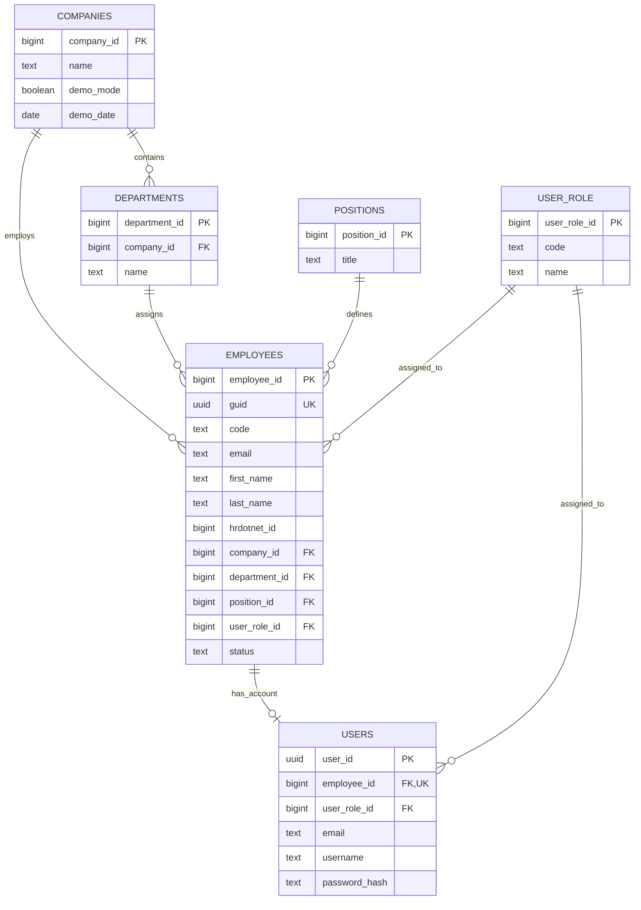

# HRDotNet Performance PMS --- Identity and Directory

**Database:** PostgreSQL\
**Schema:** `public`\
**Scope:** Company, department, position, user role, employee, and user
identity tables.

## 1. Relational diagram

## 2. Table definitions and relationships

---

Table Primary key Relationships

---

`companies` `company_id` Standalone company
record.

`departments` `department_id` `company_id` references
`companies.company_id`.

`positions` `position_id` Standalone/shared
position reference.

`user_role` `user_role_id` Standalone/shared role
reference.

`employees` `employee_id` References company,
department, position, and
user role.

`users` `user_id` References one employee
and one user role.
-------------------------------------------------------------------------

## 3. Relationship cardinality

- One company can have many departments.
- One company can employ many employees.
- One department can be assigned to many employees.
- One position can be assigned to many employees.
- One user role can be assigned to many employees.
- One employee can have zero or one user account; each user account
  belongs to exactly one employee.
- One user role can be assigned to many user accounts.

## 4. Integrity rules implemented

1.  An employee's department must belong to the same company as the
    employee. This is enforced by the composite foreign key
    `(company_id, department_id)`.
2.  Employee codes are unique within a company.
3.  Employee email addresses are unique within a company.
4.  Position titles are globally unique in this design.
5.  User-role codes and names are globally unique.
6.  User email addresses and usernames are globally unique.
7.  `users.employee_id` is unique, so an employee can have at most one
    user account.
8.  Employee status is limited to `active` or `inactive`.

## 5. Important implementation notes

- All six tables are created in PostgreSQL's `public` schema. A
  separate `pms` schema is not required for this design.
- `employees.guid` is a UUID alternate identifier; `employee_id` is
  the primary key used by the relational foreign keys.
- `employees.hrdotnet_id` is an optional external HRDotNet identifier.
- `users.password_hash` must contain a secure password hash (for
  example, Argon2id), never a plaintext password.
- `positions` and `user_role` are shared reference tables because they
  do not contain a `company_id`.
- The SQL uses `CREATE TABLE IF NOT EXISTS` for initial setup
  convenience. It is not a substitute for versioned database
  migrations when changing an existing database.
- The `updated_at` columns receive their default value on insert. They
  will need application-side updates or a database trigger when rows
  are modified.
